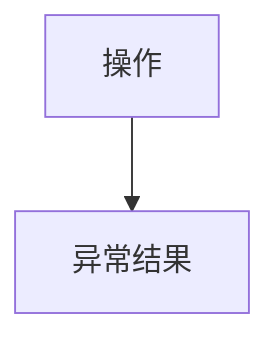
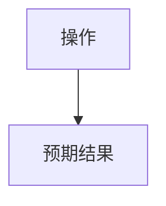
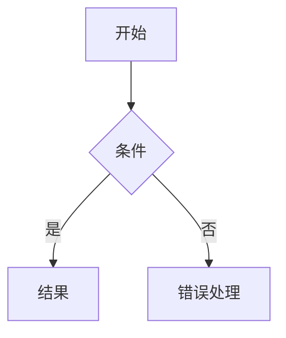

# requirements-analysis：需求分析与规格定义

> **执行契约（AlonWorkflow，优先级高于下文任何“等待用户确认 / 标记 completed”的描述：本阶段做完由编排者停下来请用户确认，你不标记完成）**
>
> - 你是子代理，**不能与用户对话**。下文写“询问/展示/等待用户确认”处：把待确认内容写进产物，并在返回的 `CONFIRM` 字段列出；信息不足以继续时写 `<SPEC_DIR>/requirements-analysis/open-questions.md`（每题附选项与默认值），返回 `STATUS: need_user`。
> - 所有产物只写 `<SPEC_DIR>/requirements-analysis/`。知识库文档写暂存区 `<SPEC_DIR>/requirements-analysis/docs/`：暂存区里已有的文件是 KB 底稿（编排者开始本阶段时用 skill `kb-sync` 从知识库带入），在它上面修改，不要整份重写；用户确认本阶段后，由编排者用 skill `kb-sync` 按合并方式提升到 `docs/<MODULE>/requirements-analysis/`，`index.md` 由 `kb-sync` 生成。不要直接写 `docs/`。
> - 本阶段必须产物以 `.aw/phases.json` 中 `requirements-analysis` 为准（需求类型可能覆盖），`python3 .aw/aw.py check <SPEC_DIR> --phase requirements-analysis` 可自检。
> - 阶段确认只能由用户在对话里给出，你不要替用户确认。
> - 前置：intake 已确认。先读 `<SPEC_DIR>/requirements-analysis/intake.md` 与 `raw-requirements.md`，按其中的需求类型裁剪 skill 链；不要重做分类。
> - `docs/flowchart.md` 除 Bug 修复外都是必须产物（门禁检查 `mermaid`）。Bug 修复类型不用 `flowchart-generator`：把错误行为、正确行为两张 mermaid 对比图写进 `<SPEC_DIR>/requirements-analysis/bug-flowchart.md`（留在 spec 侧，不进知识库）；只有正确流程本身变了，才在 `docs/flowchart.md` 的底稿上改对应 US 的图。
> - 「需求澄清」表的每条 AMB 都要有状态。只有用户在 `<SPEC_DIR>/requirements-analysis/answers.md` 里回答过，才能标「已确认」或「已忽略」，并在「依据」列引用用户原话；还没回答的写进 open-questions.md 返回 need_user。`aw check` 会拦下仍是「待确认」的条目；编排者请用户确认本阶段时，把每条 AMB 的状态和引用的原话列给用户当场核对。
> - 同一文件由多个步骤写入时，每一步只写下方模板中指定的小节，不要覆盖其他步骤的小节。

---

## 职责定位

将用户原始需求（自然语言）转化为结构化产品规格。**首先识别需求类型**，根据类型裁剪执行路径，避免对简单需求执行不必要的步骤。

---

## 输入

| 来源 | 读取文件 | 必需 | 缺失时 |
|------|---------|------|--------|
| intake | `<SPEC_DIR>/requirements-analysis/intake.md` | 是 | 返回 `STATUS: upstream_defect`（UPSTREAM: intake） |
| intake | `<SPEC_DIR>/requirements-analysis/raw-requirements.md` | 是 | 同上 |
| 共享 KB 底稿 | `<SPEC_DIR>/_shared/ontology/` 下由 `kb-sync` 带入的 `glossary.md` / `entities.md` / `business-rules.md` / `processes.md` | 否 | 首次建立 |
| 本体切片（只读） | `<SPEC_DIR>/ontology-slices/requirements-analysis.md`（编排者用 skill `ontology` 生成，存在才读） | 否 | 项目没有本体参考层（`ontology-work/views/index.json`）时不生成：跳过本体对照，并在 CONFIRM 中注明；`requirements.md` 的「涉及本体」写「无」 |
| intake（多域） | `<SPEC_DIR>/_shared/domain-map.md` | 否 | 单域，忽略 |

**本体切片怎么用**：切片是 skill `ontology` 从本体参考层（`ontology-work/views/`，由代码生成的业务对象、规则、状态、流程）里按本需求切出来的一小块，只读。开始时只有业务对象摘要；你在 `requirements.md` 写出「涉及本体」之后，编排者可以按这些编号重切，带上相关的实体、规则和状态。

---

## 输出文件

### specs 输出（可执行规格）

写入 `<SPEC_DIR>/requirements-analysis/`：

| 文件 | 内容 |
|------|------|
| `requirements.md` | 用户故事 + AC（EARS 格式） |
| `design.md` | 用户研究综合（skill market-research）、竞品分析、优先级决策（按需求类型裁剪） |
| `tasks.md` | 需求分析阶段任务列表 |
| `bug-flowchart.md` | 仅 🐛 Bug 修复（该类型必交）：错误行为、正确行为两张 mermaid 对比图；留在 spec 侧，不进知识库 |

### docs 输出（知识库文档）

写入 `<SPEC_DIR>/requirements-analysis/docs/`。暂存区里已有的文件是 KB 底稿（编排者开始本阶段时用 skill `kb-sync` 从知识库带入），在它上面修改，不要整份重写；没有底稿时首次新建。用户确认本阶段后，由编排者用 skill `kb-sync` 按下表的合并方式提升到知识库：

| 文件 | 类型 | 内容 |
|------|------|------|
| `context.md` | 必需 | 精简摘要，供下游阶段读取，**必须包含需求类型字段** |
| `flowchart.md` | 必需 | 每个 US 对应一张业务流程图（Bug 修复类型不要求；只在正确流程本身变了时改对应 US 的图） |
| `index.md` | `kb-sync` 生成 | 文件清单、合并方式、来源 spec；由 `kb-sync` 生成到知识库，不要写 |

合并方式：`context.md` 覆盖为最新；`flowchart.md` 按章节改（每个 US 一张图，只动受影响的 US）。

### 本体输出（共享知识库）

写入 `<SPEC_DIR>/_shared/ontology/`。这里已有的文件是`kb-sync` 带入的底稿（来自 `docs/_shared/ontology/`），在它上面追加；用户 用户确认后由 `kb-sync` 提升到共享知识库。本次没有新增内容时不改。

| 文件 | 类型 | 内容 |
|------|------|------|
| `<SPEC_DIR>/_shared/ontology/glossary.md` | 附加 | 术语表（只追加） |
| `<SPEC_DIR>/_shared/ontology/entities.md` | 附加 | 业务实体（只追加） |
| `<SPEC_DIR>/_shared/ontology/business-rules.md` | 附加 | 业务规则（只追加） |
| `<SPEC_DIR>/_shared/ontology/processes.md` | 附加 | 业务流程（只追加） |

原始需求已在 intake 写入 `raw-requirements.md`，由 `kb-sync` 追加到知识库；本阶段不再写原始需求。

---

## 执行步骤

上下文扫描、模块名与需求类型已在 intake 确定，直接按 `intake.md` 的「执行路径」裁剪下列步骤。

**第 1 步 — 用户研究综合（skill market-research）**（仅 🆕 新产品）
使用 skill `market-research`
输出：用户研究综合（无原始数据时只列假设和待验证问题，禁止编造数字或引语）→ 写入 `<SPEC_DIR>/requirements-analysis/design.md` 的 `## 用户研究综合` 小节

**第 2 步 — competitor-analysis**（仅 🆕 新产品）
使用 skill `competitor-analysis`
输出：竞品对比表格 → 写入 `<SPEC_DIR>/requirements-analysis/design.md` 的 `## 竞品分析` 小节

**第 3 步 — priority-matrix**（🆕 新产品 / ➕ 功能新增）
使用 skill `priority-matrix`
输出：MoSCoW 优先级矩阵 → 写入 `<SPEC_DIR>/requirements-analysis/design.md` 的 `## 优先级矩阵` 小节

**第 4 步 — feature-spec**（除 🐛 Bug 修复外均执行）
使用 skill `feature-spec`
输出：功能规格（问题、目标、非目标、需求、成功指标）→ 写入 `<SPEC_DIR>/requirements-analysis/requirements.md` 的 `## 功能规格` 小节，范围写进 `## 功能范围` 小节；skill 自带的用户故事留给第 6 步

**第 5 步 — requirements-clarify**（所有类型必须执行）
使用 skill `requirements-clarify`
输出：已确认的精确需求定义 → 写入 `<SPEC_DIR>/requirements-analysis/requirements.md` 的 `## 需求澄清` 小节；仍待用户回答的歧义写 `open-questions.md`

**第 5.5 步 — grill-with-docs（可选深挖）**
需要把需求或已有文档追问到更严时，可选使用 skill `grill-with-docs` 做深挖；不是默认必做。调用时把输出位置交给它：术语追加到本体 `<SPEC_DIR>/_shared/ontology/glossary.md`（每个术语一个 `### TERM-C<序号> 术语` 条目，写明「对应图谱」，格式见「输出文件规范」），值得记录的决策写入 `<SPEC_DIR>/requirements-analysis/design.md` 的 `## 核心决策` 小节（编号沿用 `决策 N`），未决问题写 `open-questions.md`。不要写仓库根目录的 `CONTEXT.md`、`GLOSSARY.md` 或 `docs/adr/`。

**第 6 步 — user-story-writer**（所有类型必须执行）
使用 skill `user-story-writer`
输出：完整用户故事列表（含 AC）→ 写入 `<SPEC_DIR>/requirements-analysis/requirements.md` 的 `## 用户故事` 小节
> Bug 修复类型：用户故事描述复现步骤和预期行为，而非新功能

**第 7 步 — flowchart-generator**（除 🐛 Bug 修复外均执行）
使用 skill `flowchart-generator`
输出：业务流程图 → 写入 `<SPEC_DIR>/requirements-analysis/docs/flowchart.md`

**第 7.1 步 — 错误 / 正确行为对比图**（仅 🐛 Bug 修复）
输出：错误行为、正确行为两张 mermaid 图 → 写入 `<SPEC_DIR>/requirements-analysis/bug-flowchart.md`

**本体对照**（所有类型；没有本体切片时跳过）
读 `<SPEC_DIR>/ontology-slices/requirements-analysis.md`，然后：
- 在 `requirements.md` 的 `## 涉及本体` 小节写一行 `涉及本体：ENT-…、BR-…`：本需求用到的参考层编号，只写编号，从切片的摘要表里查。
- 用户故事、AC 和需求澄清里的业务名词用切片里的中文名；已有的对象不要另起名字。中文名标「待确认」的也可以用，编排者请用户确认时会把它们列出来。
- 切片里已经有的实体、规则不要再抄进流程层；只有图谱里没有、或要补充的内容才写进下面的「本体补充」，并在「对应图谱」写它对应的编号。

**本体补充**（所有类型；本次没有新增时跳过）
在 `<SPEC_DIR>/_shared/ontology/` 的底稿上追加本次新出现的术语（`glossary.md`）、业务实体（`entities.md`）、业务规则（`business-rules.md`）和业务流程（`processes.md`），格式见「输出文件规范」。

---

## 执行规范

1. 按 `intake.md` 的需求类型与执行路径裁剪步骤（不要重做分类）
2. 按裁剪后的路径执行对应 Skills
3. 展示 AMB 列表，等待用户确认所有模糊需求：未回答的 AMB 写进 open-questions.md 返回 need_user；用户的回答由编排者写进 answers.md，再把对应 AMB 标为已确认 / 已忽略并引用原话
4. 将确认后的定义更新到用户故事
5. 用户确认后，生成所有输出文件，标记阶段为 `completed`

---

## 输出文件规范

### <SPEC_DIR>/requirements-analysis/requirements.md

```markdown
# Requirements Analysis — Requirements

## 需求类型
{🆕 新产品 / ➕ 功能新增 / 🔧 重构 / 🐛 Bug 修复 / 🎨 UI/UX 调整}

## 执行路径
跳过：{跳过的 Skills，如无则填"无"}
执行：{实际执行的 Skills}

## 涉及本体
涉及本体：{本需求用到的参考层编号，如 ENT-order、BR-order-amount-limit；没有本体切片时写「无」}

## 功能范围

### In Scope（本次交付）
| 功能点 | 优先级 | 说明 |
|--------|--------|------|

### Out of Scope
- {排除项}：{原因}

## 功能规格
{问题陈述、目标、非目标、需求、成功指标（来自 feature-spec；Bug 修复类型写缺陷现象与影响）}

## 需求澄清
| AMB ID | 原始描述 | 确认后的定义 | 状态 | 依据 |
|--------|---------|-------------|------|------|
| AMB-001 | {原文里模糊的说法} | {用户确认后的精确定义} | 待确认 / 已确认 / 已忽略 | answers.md：「{用户原话}」 |

## 用户故事

### US-001：{故事标题}
**As a** {用户角色} **I want to** {操作} **So that** {价值}
**Priority**: P0 | **Related goal**: BG-01

**Acceptance Criteria**:
- AC-001-1: GIVEN {前置} WHEN {操作} THEN {结果}

## 验收标准（EARS 格式）

### AC-REQ-1
WHEN {条件} THEN 系统 SHALL {行为}
```

### <SPEC_DIR>/requirements-analysis/design.md

```markdown
# Requirements Analysis — Design

## 需求类型
{类型} — 本文件仅包含适用于该类型的分析内容

## 商业目标
- BG-01: {目标描述，可量化}（Bug 修复类型填"修复缺陷，恢复正常功能"）

## 用户研究综合（仅 🆕 新产品）
{市场规模、目标用户画像、核心痛点}

## 竞品分析（仅 🆕 新产品）
| 功能点 | 本产品 | 竞品 A | 竞品 B | 差异化机会 |
|--------|--------|--------|--------|-----------|

## 优先级矩阵（🆕 新产品 / ➕ 功能新增）

### Must Have（P0）
| 功能 | 理由 |
|------|------|

## 核心决策

### 决策 1：{功能范围定义}
- **选择**：{选择了哪些功能作为 P0}
- **理由**：{依据}
- **权衡**：{接受的取舍}
```

### <SPEC_DIR>/_shared/ontology/glossary.md（附加，只追加）

```markdown
# Glossary

### TERM-C{序号} {名称}
- **对应图谱**：{这个术语说的是哪个对象，如 ENT-order；图谱里没有写「未覆盖」}
- **定义**：{一句话定义}
- **避免的叫法**：{同义词或易混的叫法}
- **来源 spec**：{spec 目录名}
```

### <SPEC_DIR>/_shared/ontology/entities.md（附加，只追加）

```markdown
# Entities

### ENT-C{序号} {名称}
- **对应图谱**：{参考层编号，如 ENT-order；图谱里没有写「未覆盖」}
- **定义**：{实体是什么}
- **关键属性**：{属性列表}
- **所属模块**：{模块名}
- **来源 spec**：{spec 目录名}
```

### <SPEC_DIR>/_shared/ontology/business-rules.md（附加，只追加）

```markdown
# Business Rules

### BR-C{序号} {名称}
- **对应图谱**：{参考层编号，如 BR-order-amount-limit；图谱里没有写「未覆盖」}
- **规则**：{必须成立的业务约束}
- **约束对象**：{实体编号，如 ENT-order 或本层的 ENT-C1}
- **来源 spec**：{spec 目录名}
```

### <SPEC_DIR>/_shared/ontology/processes.md（附加，只追加）

```markdown
# Processes

### BP-C{序号} {名称}
- **对应图谱**：{参考层编号，如 BP-submit-order；图谱里没有写「未覆盖」}
- **触发条件**：{什么时候开始}
- **操作的对象**：{实体编号}
- **来源 spec**：{spec 目录名}
```

每个条目的标题写成 `### <类型>-C<序号> 名称`（如 `### ENT-C1 订单备注`；序号在本文件、本前缀下从 1 递增，用过的不复用），条目里要再分小节时只用 `####`。每条新条目必须写「对应图谱」：`ontology-work/views/index.json` 里的参考层编号，图谱里没有就写「未覆盖」。只追加：已有条目（标题和正文）一个字都不能改，也不能删；要修正旧条目时追加一个新条目并写 `取代：<旧编号>`。`kb-sync` 提升时逐条比对，并核对「对应图谱」编号存在。

### <SPEC_DIR>/requirements-analysis/bug-flowchart.md（仅 🐛 Bug 修复，留在 spec 侧）

````markdown
# Bug 对比图

## 错误行为
{bug 的触发路径和异常结果}



## 正确行为
{修复后的正确流程}


````

### <SPEC_DIR>/requirements-analysis/docs/flowchart.md

````markdown
# Requirements Analysis — Flowchart

## US-001：{故事标题}


````

Bug 修复类型的对比图写在 `bug-flowchart.md`（见上），不写进本文件；只有正确流程本身变了，才在底稿上改受影响 US 的图。

### <SPEC_DIR>/requirements-analysis/docs/context.md

```markdown
# Requirements Analysis Context → 下游阶段

## 模块名称
<MODULE>

## 需求类型
{🆕 新产品 / ➕ 功能新增 / 🔧 重构 / 🐛 Bug 修复 / 🎨 UI/UX 调整}

## 后续阶段执行路径
- 交互设计：{执行 / 跳过，原因}
- 技术方案：{全部执行 / 裁剪执行，说明跳过的 Skills}
- 测试验证：{全部执行 / 裁剪执行}

## 归档路径
docs/<MODULE>/
<SPEC_DIR>/

## 商业目标
- BG-01: {目标描述，可量化}

## 功能范围

### In Scope（P0 优先）
| 功能点 | 优先级 | 说明 |
|--------|--------|------|

### Out of Scope
- {排除项}：{原因}

## 用户故事摘要
| US ID | 标题 | 优先级 | AC 数量 |
|-------|------|--------|---------|

## AC 完整列表
- AC-001-1: GIVEN {前置} WHEN {操作} THEN {结果}

## 数据实体
- {实体名}：{字段列表}

## 系统集成点
| 集成目标 | 方向 | 用途 |
|---------|------|------|

## 关键约束
- {约束描述}

## 状态
confirmed
```

---

## 完整性校验

| 文件 | 位置 | 缺失时 |
|------|------|--------|
| `requirements.md` | specs | 校验失败，阶段保持 `in_progress` |
| `design.md` | specs | 校验失败，阶段保持 `in_progress` |
| `tasks.md` | specs | 校验失败，阶段保持 `in_progress` |
| `context.md` | docs | 校验失败，阶段保持 `in_progress` |
| `index.md` | docs | `kb-sync` 生成（不要写） |
| `flowchart.md` | docs | 校验失败，阶段保持 `in_progress`（Bug 修复以外必需，需含 mermaid 图） |
| `bug-flowchart.md` | specs | Bug 修复类型校验失败（需含错误行为、正确行为两张 mermaid 图） |
| requirements.md 的「涉及本体」小节 | specs | 不阻断（门禁不检查）；有本体切片时应写，skill `ontology` 按它重切后续阶段的切片，没写时按名称猜 |
| `requirements.md` 的「需求澄清」 | specs | 有 AMB 待确认，或已确认 / 已忽略没有引用 answers.md 里的原话：校验失败 |
| `glossary.md` / `entities.md` / `business-rules.md` / `processes.md` | _shared/ontology | 附加，门禁不检查是否存在（不阻断）；写了的话，标题不是条目格式、新条目缺「对应图谱」或编号不存在、改动旧条目时 `kb-sync` 提升会被拒绝 |

所有必需文件均为 `generated` → 校验通过，标记 requirements-analysis 为 `completed`。

---

## 返回格式（给编排者，≤20 行，不贴文件正文）

```
STATUS: done | need_user | upstream_defect
FILES: <本次写入/修改的相对路径>
CONFIRM: <需要用户复核的要点，≤5 条>
UPSTREAM: <upstream_defect 时写 "<phase>: <原因>"，否则留空>
```
