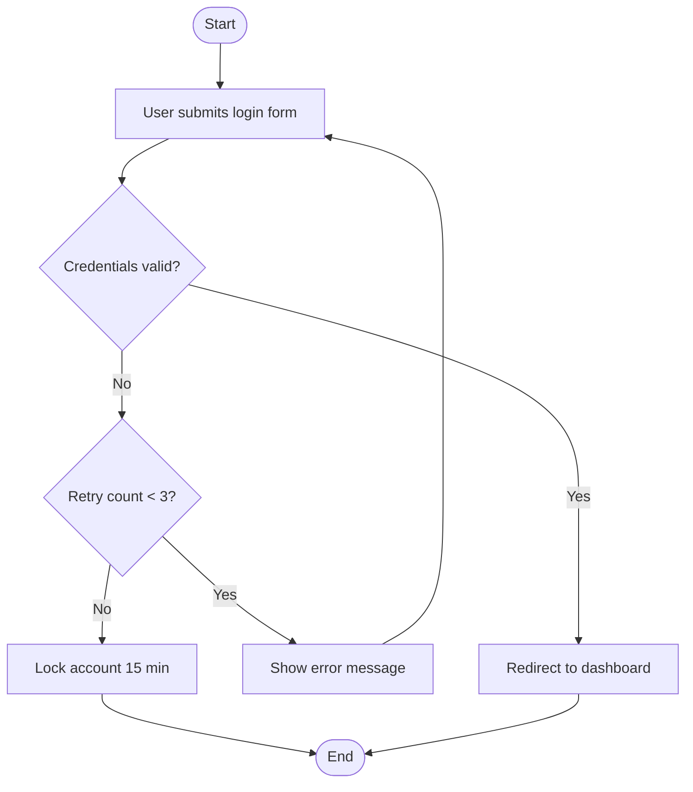

# Flowchart Generator

Convert a plain-text process description into a standard Mermaid flowchart ready to embed in any Markdown document.

## When to Use

- BA: Generating business process diagrams (`businessFlow` field in BA Spec)
- UX: Generating user operation flow diagrams (`userFlows` field in UX Spec)

## 输入

输入可以是调用方或用户给出的文件，也可以是对话里的内容。独立使用且没有指定时，按「内容」列括号里的默认文件名在当前目录查找。

| 项 | 必需 | 内容 | 缺失时 |
|----|------|------|--------|
| 流程描述 | 是 | 业务流程或用户操作流程的文字描述 | 停止，请用户提供 |

示例输入（仅示意，字段不是必填项）：

```
flowDescription: "User submits login form → system validates credentials → if valid, redirect to dashboard; if invalid, show error and allow retry up to 3 times → after 3 failures, lock account for 15 minutes"
```

## 输出

- 默认文件：`flowchart.md`
- 写入位置：调用方指定了位置就写到那里；否则写到用户指定的路径；都没有时写当前目录的 `./flowchart.md`。
- 格式：Markdown，每张图一个 `## {Flow Name}` 小节，小节内是一个 Mermaid 代码块，见下方「Output Format」。
- 必需小节：`## {Flow Name}`

## Output Format

````markdown
## {Flow Name}


````

## Mermaid Syntax Rules

| Node Type | Syntax | Use For |
|-----------|--------|---------|
| Process step | `[Text]` | Regular action or step |
| Decision | `{Text}` | Condition or branch point |
| Start/End | `([Text])` | Terminal nodes |
| Data store | `[(Text)]` | Database or storage |

- Default direction: `flowchart TD` (top-down)
- Labeled edges: `-->|label|`
- Group related steps with `subgraph`
- Keep node labels concise (≤10 words)

## Execution Rules

1. Identify all steps, decision points, and branches from the description
2. Every flowchart must have explicit start and end nodes
3. All decision nodes must have labeled outgoing edges for each branch
4. If the description is too vague to generate a valid diagram, output a numbered step list marked "flowchart pending" — do not block the main workflow

## Failure Handling

If input is ambiguous: output a plain numbered list of steps with a note `<!-- flowchart pending: clarify [specific ambiguity] -->` and continue.
