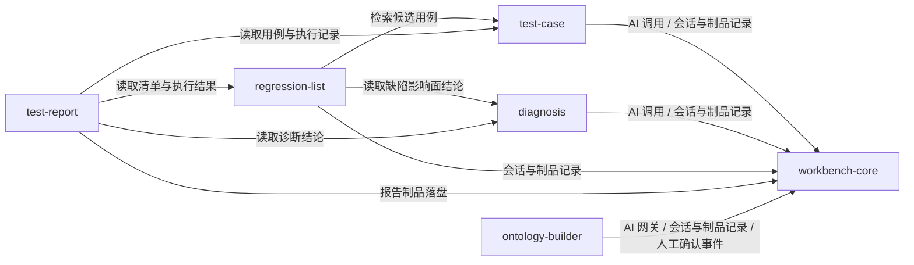

# 项目域地图

## 域清单

| 域名称 | module-name | 类型 | 优先级 | 状态 |
|---|---|---|---|---|
| 工作台基座 | `workbench-core` | 通用域 | P0 | 🚧 进行中（spec `ai-test-workbench_20261117184149`；2026-11-17 20:50:31 收窄为纯基座） |
| 知识库 | `knowledge-base` | 支撑域 | P0 | 🚧 进行中（已从 `workbench-core` 拆出，spec `knowledge-base_20261117205011`） |
| 仓库集成 | `repo-integration` | 支撑域 | P0 | 🚧 进行中（已从 `workbench-core` 拆出，spec `repo-integration_20261117205011`） |
| 本体生成域 | `ontology-builder` | 支撑域 | P1 | ⏳ 待排期（立项顺序未定；依赖 `workbench-core` 的 AI 网关、会话、制品与人工确认，导入能力属 `knowledge-base`） |
| 用例域 | `test-case` | 核心域 | P0 | ⏳ pending |
| 诊断域 | `diagnosis` | 核心域 | P0 | ⏳ pending |
| 回归清单域 | `regression-list` | 支撑域 | P1 | ⏳ pending |
| 测试报告域 | `test-report` | 支撑域 | P1 | ⏳ pending |

各域职责与主要实体：

| module-name | 核心职责 | 主要实体 |
|---|---|---|
| `workbench-core` | 6 个入口的导航与任务编排；AI 模型接入；输入采集（文本粘贴 / 文件上传）；项目上下文（人工填写）；分析会话与制品落盘 | Session, SessionEvent, Artifact, AiCallRecord, ProjectContext |
| `knowledge-base` | 知识库文件导入与编号索引；条目浏览、检索、按编号勾选注入；新鲜度与版本冲突提示；删除（从 `workbench-core` 迁出的 US-012 ~ US-016） | KnowledgeBase, KnowledgeEntry |
| `repo-integration` | 云效 / GitHub 仓库只读绑定与令牌管理；连通性测试；手动同步元数据；仓库 / 分支 / 提交 / 目录树浏览；按需读取单文件（从 `workbench-core` 迁出的 US-017 ~ US-023） | CodeRepoBinding, RepoSyncRecord, RepoMetadataSnapshot, RepoFileReadRecord |
| `test-case` | 从需求/PRD 生成测试用例；用例记录、筛选、回放（README 定位） | TestCase, CaseTag, CaseRun |
| `diagnosis` | Bug 分析、日志排查、SQL 分析三类诊断入口 | DiagnosisSession, Finding, LogSource, SqlSource |
| `regression-list` | 按变更范围与影响面从用例库挑选并排序回归用例 | RegressionScope, RegressionItem |
| `test-report` | 汇总清单、执行结果与诊断结论生成测试报告 | TestReport, ReportSection |
| `ontology-builder` | 内嵌 `ontology-builder-native` 的生成链路：扫描业务场景、生成顶层与业务本体、人工确认；产出 `index.json` 与 md 知识库文件。本期未实现，后续复用 `workbench-core` 的 AI 网关、会话、事件、制品与人工确认能力 | OntologyDraft, OntologyScan, BuilderConfirmation |

## 交付形态

Web 应用：浏览器访问的 Web 前后端（非桌面端、非纯 CLI）。依据：用户答复「3.交付web应用」。

本阶段只推进 `workbench-core` 域；其余域在用户单独 `aw-start` 后接入，跨域接口以本文件「跨域接口约定」为准。2026-11-17 20:50:31 按用户决策拆为 3 个 spec：知识库（`knowledge-base_20261117205011`）与仓库集成（`repo-integration_20261117205011`）已从 `workbench-core` 迁出并各自独立立项；`workbench-core` 不再拥有知识库、仓库绑定或仓库元数据。

## 域间依赖

## 跨域接口约定

| 调用方 | 被调用方 | 接口类型 | 说明 |
|---|---|---|---|
| `test-case` | `workbench-core` | 进程内 API | `ai.complete(prompt, context)` 统一模型调用，记录调用审计 |
| `diagnosis` | `workbench-core` | 进程内 API | 同上；输入制品经 `artifacts.save(sessionId, file)` 落盘 |
| `regression-list` | `test-case` | 进程内 API | `cases.search(scope)` 按变更范围/标签检索候选用例，只读 |
| `regression-list` | `diagnosis` | 进程内 API | `diagnosis.findings(projectId)` 读取缺陷影响面结论，只读 |
| `regression-list` | `workbench-core` | 进程内 API | 会话创建与清单制品落盘 |
| `test-report` | `regression-list` | 进程内 API | `regression.get(listId)` 读取清单，只读 |
| `test-report` | `test-case` | 进程内 API | `cases.runs(ids)` 读取执行结果，只读 |
| `test-report` | `diagnosis` | 进程内 API | `diagnosis.findings(projectId)` 读取诊断结论，只读 |
| `test-report` | `workbench-core` | 进程内 API | 报告制品落盘与会话记录 |
| `ontology-builder` | `workbench-core` | 进程内 API | 复用 `ai.complete`、会话与制品、人工确认事件；生成结果以 `index.json` + `.md` 上传导入知识库（导入能力现属 `knowledge-base`，本期未实现） |
| `knowledge-base` | `workbench-core` | 进程内 API | 注入组装的提示经 `ai.complete` 发起调用并写入 AiCallRecord / SessionEvent；只按 `projectId` 引用项目，不读写 core 数据表 |
| `repo-integration` | `workbench-core` | 进程内 API | 解析到的文件内容若被引用进分析，按文本输入口径走 `ai.complete`（计入 200,000 字符）；不写 core 的会话与制品 |
| 后续业务域 | `repo-integration` | 进程内 API | 按 `repoBindingId` 只读引用仓库 / 分支 / 提交 / 目录树与按需文件内容；不跨域读令牌、不自行直连代码托管平台。接口名与签名待该 spec 技术方案确认 |
| 后续业务域 | 云效 / GitHub | 禁止直连 | 仓库访问只由 `repo-integration` 持有令牌并发起；其他域不得保存或读取仓库令牌，也不得自行克隆仓库 |

跨域调用约定：只通过被调用方暴露的查询/写入接口，不跨域直接读写对方数据表或数据文件；被调用方是本域唯一的数据所有者。

## 共享数据约定

| 数据项 | 所有域 | 其他域引用方式 |
|---|---|---|
| `projectId` | `workbench-core` | 通过 ID 引用项目上下文（仓库、需求来源），不跨域查询项目表 |
| `sessionId` | `workbench-core` | 各域只向本会话追加事件与制品，不复制会话数据 |
| `artifactId` / 制品路径 | `workbench-core` | 按 `sessions/<sessionId>/` 隔离落盘，其他域只读引用 |
| `caseId` | `test-case` | 其他域通过 ID 引用用例，不跨域写用例数据 |
| `listId` | `regression-list` | `test-report` 只读引用清单 |
| 模型提供商与密钥 | `workbench-core` | 只由基座持有，其他域不得自行直连模型或读取密钥 |
| `kbId` / 知识库编号（`TERM-` / `ENT-` / `ST-` / `BR-` / `BP-` / `API-` / `DE-`） | `knowledge-base` | 知识库由 `knowledge-base` spec 存储与索引，其他域只按编号引用条目，不直接读写知识库文件（原属 `workbench-core`，2026-11-17 20:50:31 迁出） |
| `repoBindingId` / 仓库元数据（仓库、分支、提交、目录树） | `repo-integration` | 其他域按 `repoBindingId` 只读引用元数据与按需文件内容；仓库访问令牌与同步控制权只属 `repo-integration`，其他域不得保存令牌或自行克隆仓库（原属 `workbench-core`，2026-11-17 20:50:31 迁出） |

## 执行进度

| module-name | 状态 | spec | 关闭时间 |
|---|---|---|---|
| `workbench-core` | ✅ 已完成 | `ai-test-workbench_20261117184149` | 2026-11-18 16:42 |
