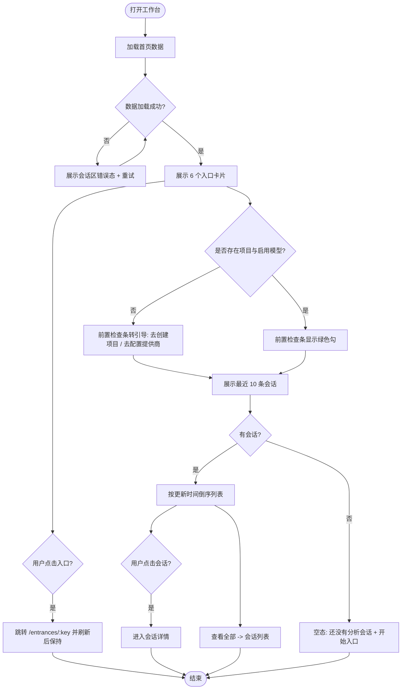
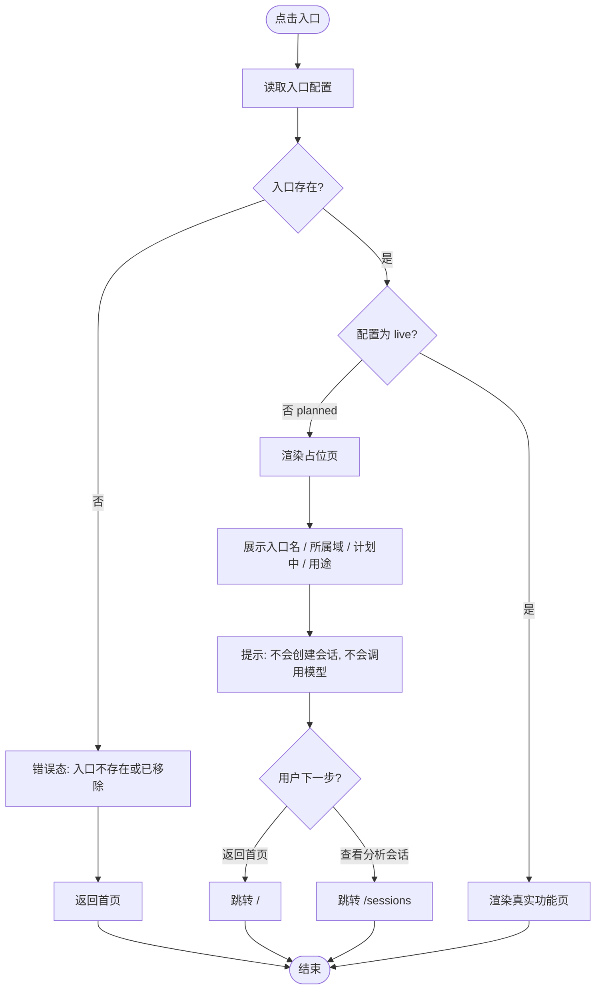
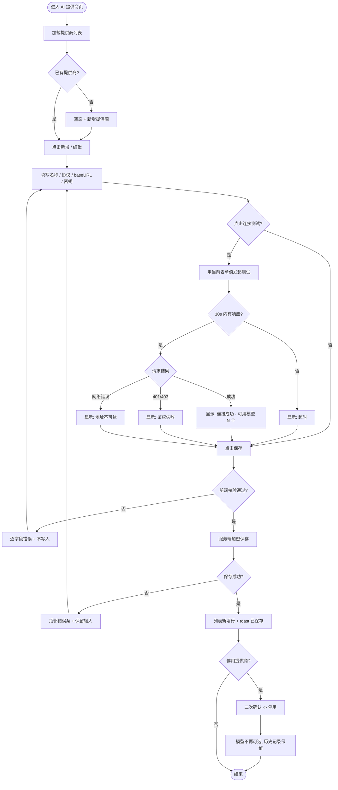
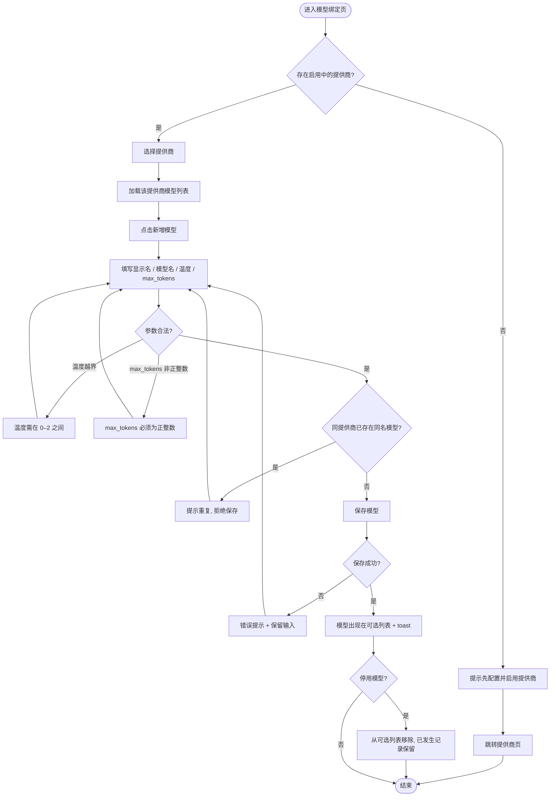
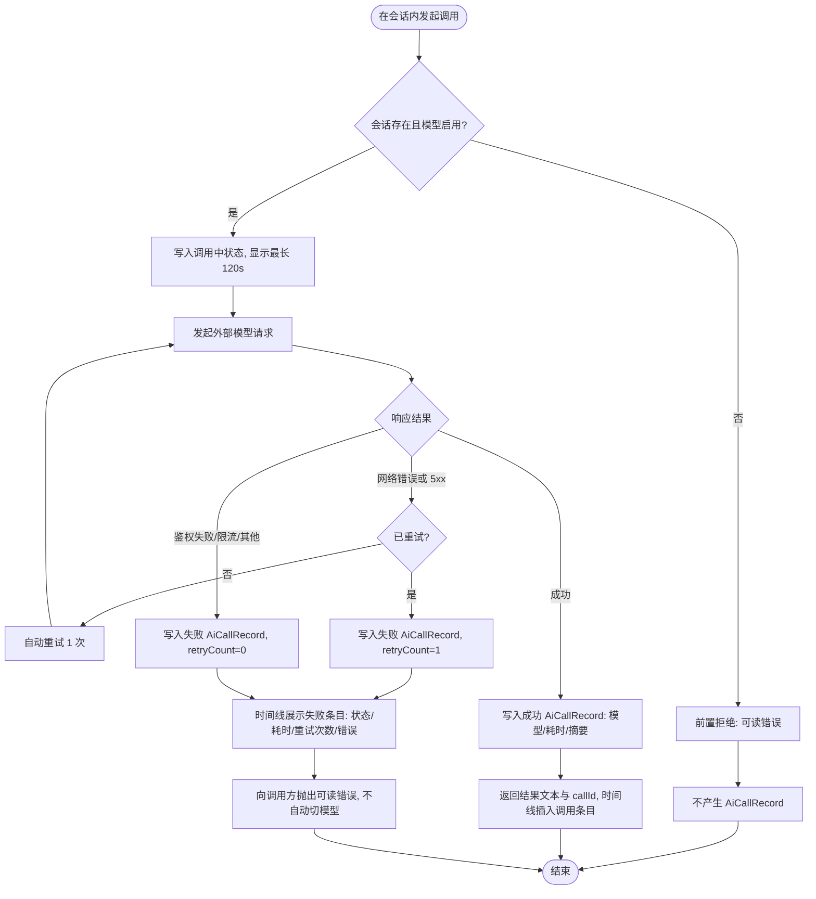
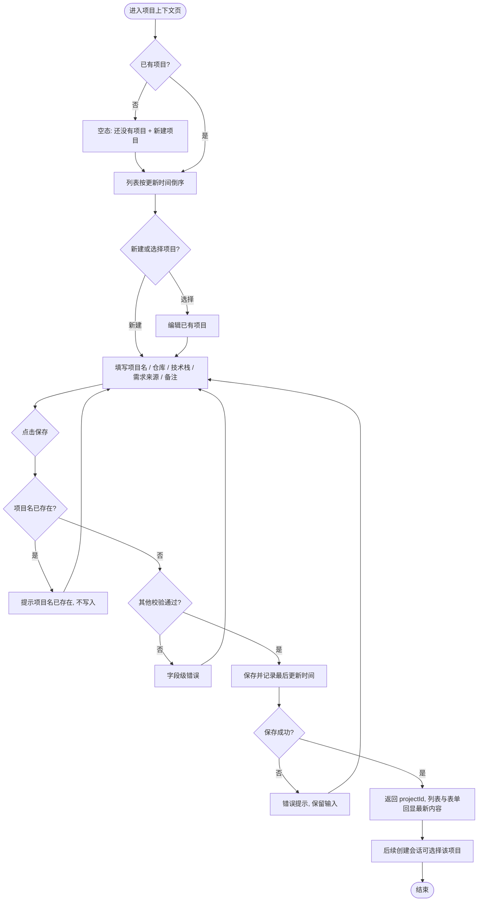
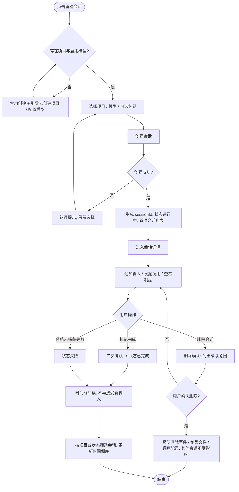
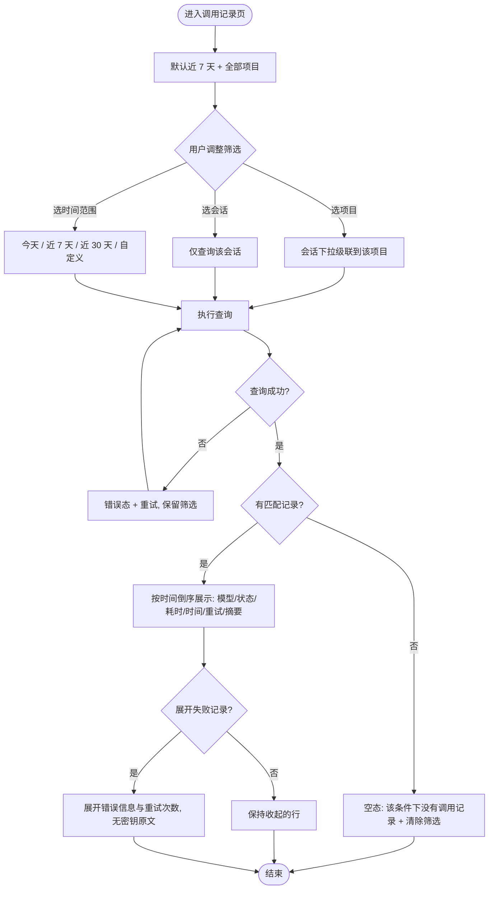
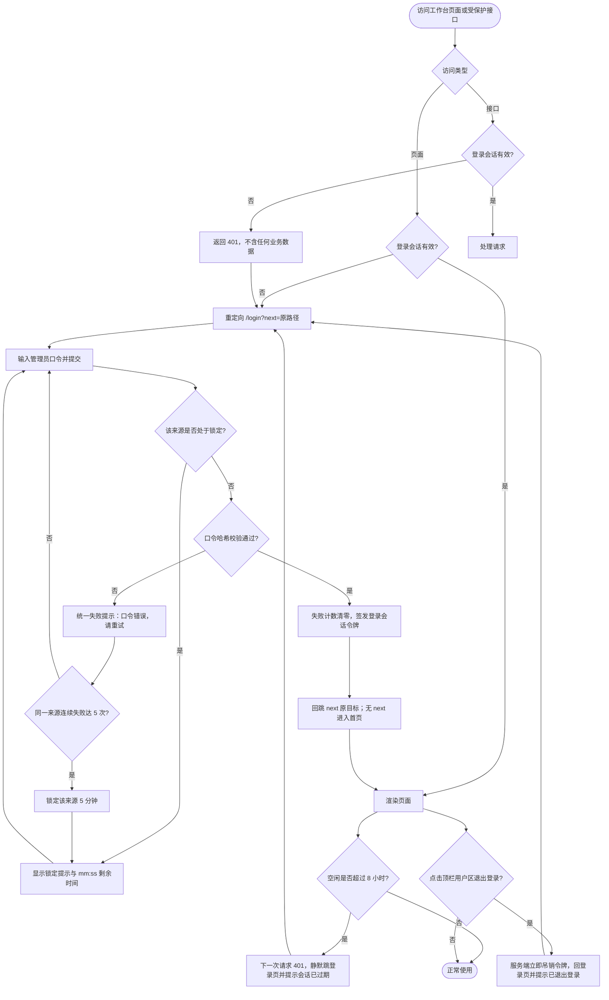

# Interaction Design — 用户操作流程图

> 每个 US 一张流程图，节点文案与线框图、demo.html 一致。
>
> 2026-11-17 收窄：本 spec 只保留 workbench-core 的 US-001 ~ US-011；知识库（US-012 ~ US-016）已迁出到 `specs/knowledge-base_20261117205011`，对应流程图见该 spec。

## US-001 首页进入六类入口



## US-002 进入未交付入口



## US-003 配置提供商并连接测试



## US-004 为提供商绑定模型



## US-005 统一调用 AI 并记录每次调用



## US-006 粘贴文本作为分析输入

```mermaid
flowchart TD
    A([打开文本粘贴 Tab]) --> B[填写标题(可选)与正文]
    B --> C[实时更新字数 x / 200,000]
    C --> D{点击添加到时间线}
    D --> E{正文为空或仅空白?}
    E -->|是| E1[提示正文必填, 提交按钮禁用] --> B
    E -->|否| F{正文 > 200,000 字符?}
    F -->|是| F1[提示当前字数与上限, 拒绝提交, 不截断] --> B
    F -->|否| G[提交]
    G --> H{提交成功?}
    H -->|否| H1[错误提示, 保留输入] --> B
    H -->|是| I[追加 SessionEvent, 时间线插入输入事件]
    I --> J[清空输入框 + toast 已添加到时间线]
    J --> K[该输入可在后续调用中被勾选引用] --> Z([结束])
```

## US-007 上传文件作为分析输入

```mermaid
flowchart TD
    A([打开上传 Tab]) --> B[拖拽或选择文件]
    B --> C[前端逐文件校验]
    C --> D{类型在白名单?}
    D -->|否| R[标红: 不支持该类型 + 允许范围]
    D -->|是| E{单文件 ≤ 10MB?}
    E -->|否| R2[标红: 超过 10MB]
    E -->|是| F{本次 ≤ 10 个?}
    F -->|否| R3[标红: 单次最多 10 个]
    F -->|是| G{存在不合规文件?}
    R --> G
    R2 --> G
    R3 --> G
    G -->|是, 用户移除后重试| B
    G -->|用户仍提交| G1[拒绝并说明允许范围, 不写入制品] --> Z([结束])
    G -->|否| H[上传保存为会话制品]
    H --> I{同会话已存在同名文件?}
    I -->|是| I1[自动改名 app-1.log 并保留两份]
    I -->|否| J[使用原文件名]
    I1 --> K[时间线插入上传事件 + 制品卡片]
    J --> K
    K --> L[展示前 20 行预览 / 大小 / 下载]
    L --> M[显示改名提示(如有)] --> Z
```

## US-008 维护项目上下文



## US-009 创建分析会话并回看历史



## US-010 查询 AI 调用记录



## US-011 登录、会话过期与登出


