# Requirements Analysis — Flowchart

> 范围：`workbench-core` 域。每个用户故事一张图；未交付域的业务流程不在本文件。
>
> 登录前置校验：US-001 ~ US-010 的每一步都发生在已登录状态。未登录或登录会话失效时，所有页面与受保护接口统一由 US-011 的登录流程拦截（页面跳转登录页 / 接口 401），不进入下列业务流程。
>
> 六入口名称（AMB-019）：用例库、分析 bug、排查日志、分析 SQL、生成回归清单、生成测试报告。原「生成测试用例」更名为「用例库」，生成用例能力作为该入口内部功能。

## US-001：从首页进入六类工作入口

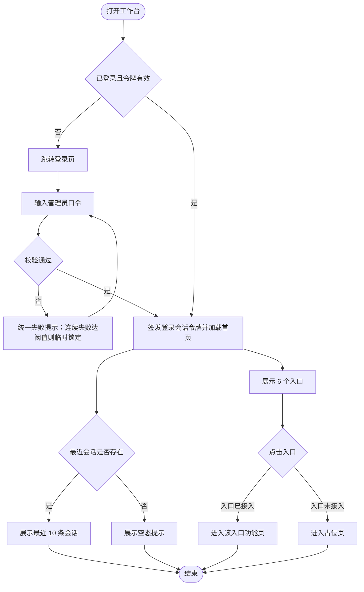

## US-002：进入尚未交付的入口

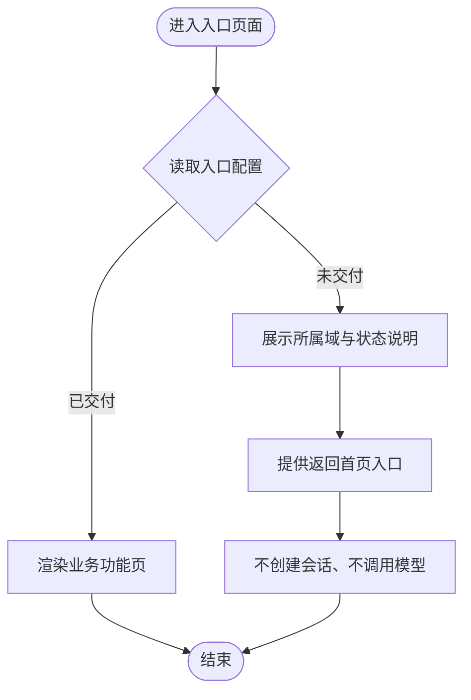

## US-003：配置 AI 提供商并验证连通

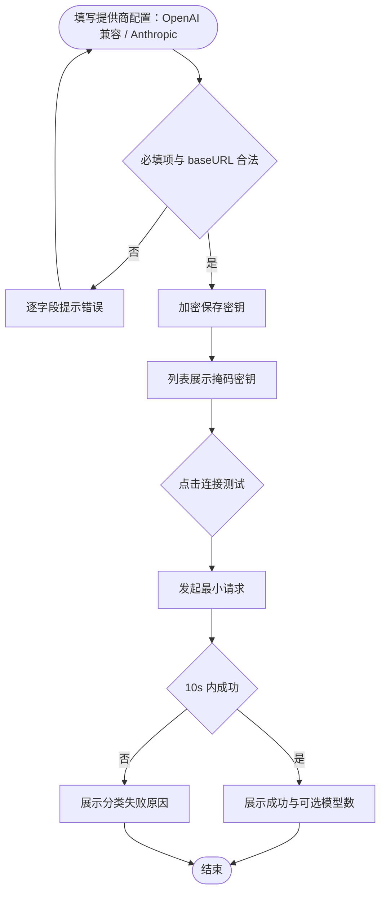

## US-004：为提供商绑定模型

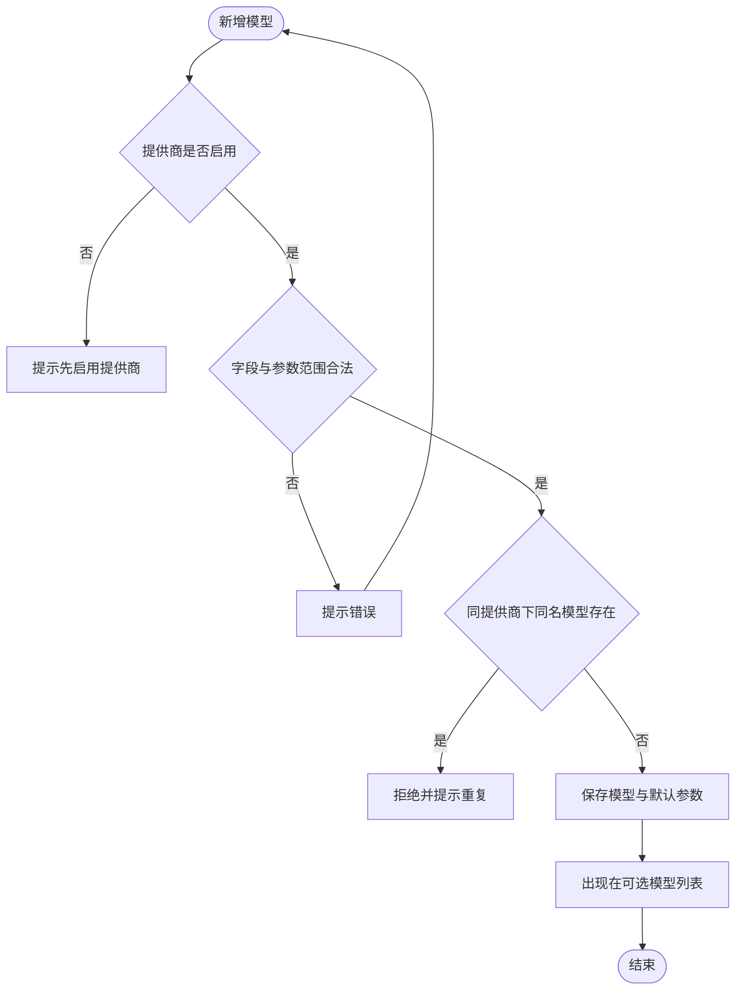

## US-005：统一调用 AI 并记录每次调用

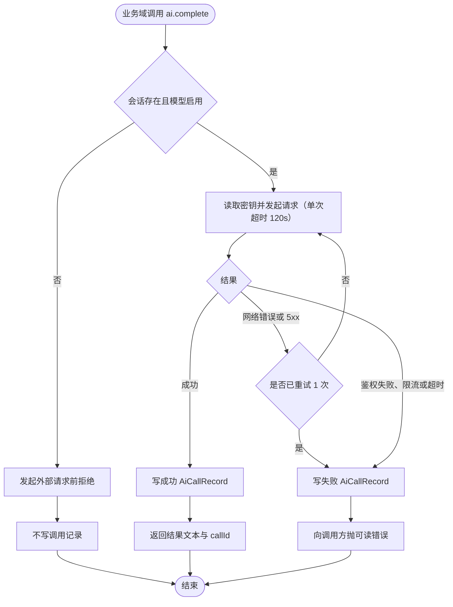

## US-006：粘贴文本作为分析输入

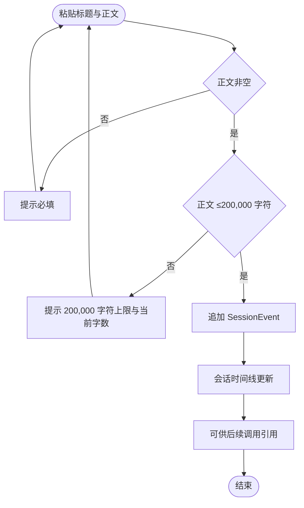

## US-007：上传文件作为分析输入

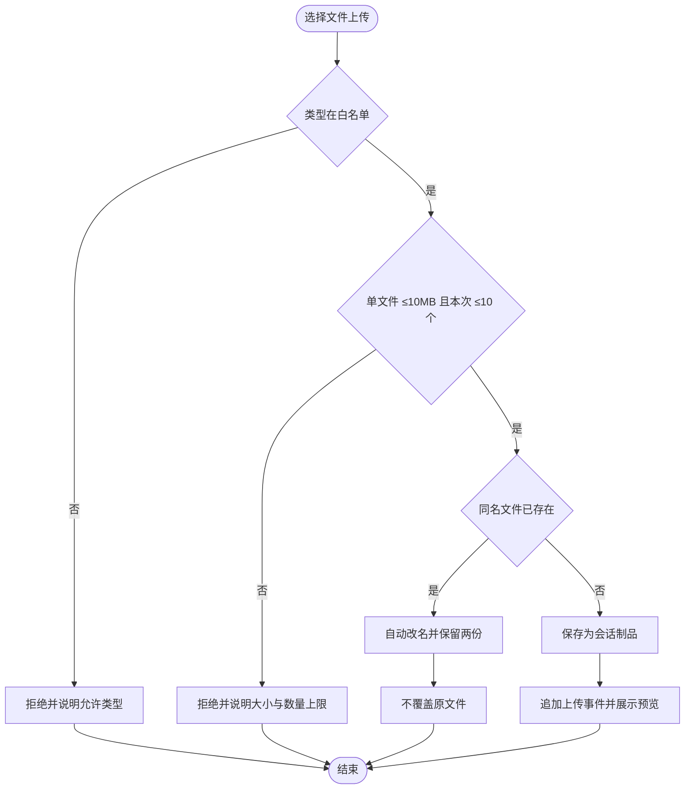

## US-008：维护项目上下文

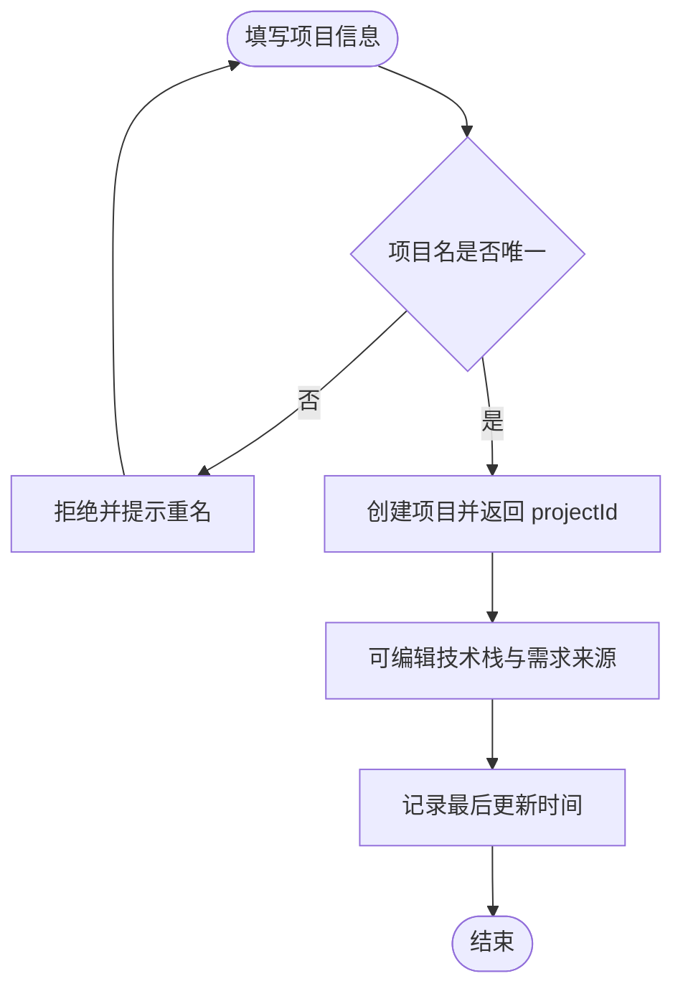

## US-009：创建分析会话并回看历史

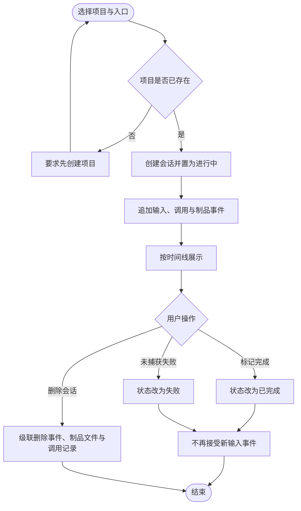

## US-010：查询 AI 调用记录

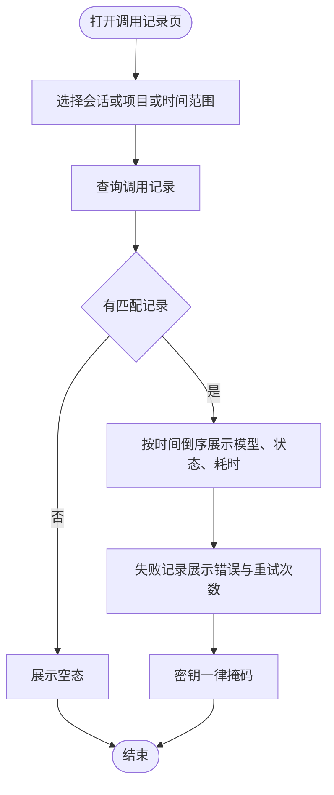

## US-011：以单用户身份登录后使用工作台

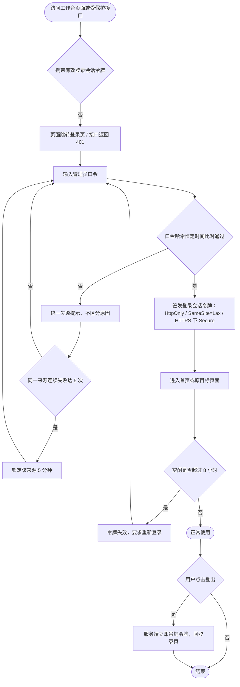

## 已迁出的流程图（US-012 ~ US-023）

US-012 ~ US-016（知识库 5 张）与 US-017 ~ US-023（仓库集成 7 张）的 mermaid 图已随需求迁出，原文见：

- `specs/knowledge-base_20261117205011/_handoff/from-workbench-core.md` 第 5 节
- `specs/repo-integration_20261117205011/_handoff/from-workbench-core.md` 第 5 节
