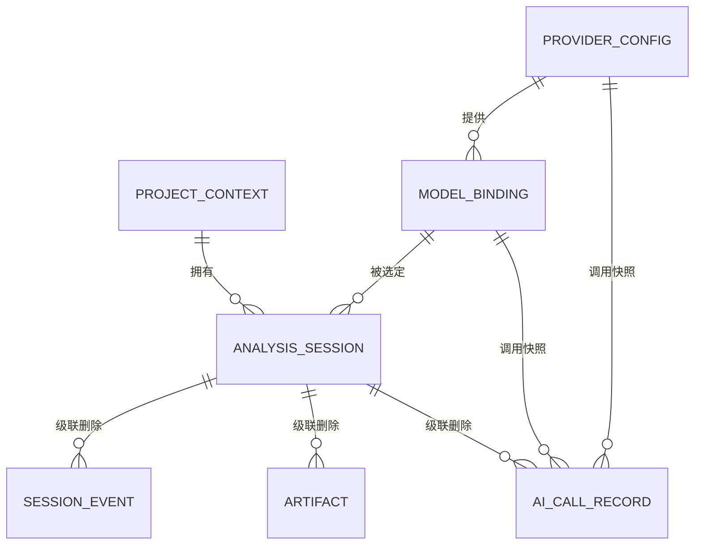

# Database Schema（数据库 Schema）— workbench-core

> **文档状态：draft — 2026-11-18 因跨 spec 知识库注入扩展（A101 / A102 / A103 B）变更，待用户重新确认。**

> 阶段：tech-design（步骤 5，`data=yes`）。上游：`technical-design/docs/architecture-decisions.md`（architecture-locked，2026-11-18 用户重新确认）、`requirements-analysis/docs/context.md`、`interaction-design/docs/context.md`。
> 生产 MySQL 8.4 LTS（InnoDB / utf8mb4 / `utf8mb4_0900_ai_ci`）；开发与默认测试 SQLite（aiosqlite）。所有类型与写法必须同时成立（ADR-015 / ADR-016 / ADR-017）。
> 本 spec 只含 `workbench-core` 的 10 张表；知识库与仓库集成不在此处，由各自 spec 扩展。

## 实体关系图



> `admin_credential` / `login_session` / `login_attempt` 为认证侧独立表，不与业务表建外键。完整字段级 ER 见 `docs/flowchart.md` §8。

## 1. 通用约定

### 1.1 标识与字段类型

| 约定 | 写法 | 说明 |
|------|------|------|
| 主键 | `BigInteger().with_variant(Integer, "sqlite")` 自增 | 对外 API 以 JSON number 暴露，进程内服务签名用 `int` |
| 时间 | `DateTime()`（应用写 UTC naive） | MySQL 侧 `DATETIME(6)`；禁止 `NOW()`、`CURRENT_TIMESTAMP`、数据库时区语义 |
| 布尔 | `Boolean` | MySQL `TINYINT(1)`，SQLite 0/1；仓库只存 Python `bool` |
| JSON | `sqlalchemy.JSON` | 仅 `session_event.payload`；不建索引、不做方言专属查询 |
| 长文本 | `Text().with_variant(mysql.MEDIUMTEXT(), "mysql")` | `result_text`、项目备注/需求来源 |
| 哈希列 | `CHAR(64)` | SHA-256 十六进制；`token_hash` / `source_ip_hash` / `prompt_digest` |
| 被索引的字符串 | `VARCHAR(≤191)` | utf8mb4 下 191×4=764 字节，安全低于 3072 |
| 大小写归一列 | `*_key VARCHAR(...) COLLATE utf8mb4_bin`，值为 Python `casefold()` | MySQL 默认 ai_ci 与 SQLite 默认 BINARY 的差异靠这一列消除 |
| 表参数 | `{"mysql_engine": "InnoDB", "mysql_charset": "utf8mb4", "mysql_collate": "utf8mb4_0900_ai_ci"}` | Alembic `__table_args__` 显式声明 |
| 约束命名 | `pk_` / `fk_` / `uq_` / `ix_` / `ck_` + 表名 + 列名 | Alembic `naming_convention`，保证双方言命名一致、迁移可回滚 |
| CHECK | 枚举列全部加 `CheckConstraint` | MySQL 8.0.16+ 与 SQLite 均执行；值用英文枚举 |

**禁止**：方言专属 DDL、`ON DUPLICATE KEY`、`INSERT OR REPLACE`、`NOW()`、`TEXT` 前缀索引、区分大小写的唯一约束。

### 1.2 级联与删除口径

- 只有「删除整个会话」一个用户删除入口（AC-009-5 / AMB-009）。
- `project_context` / `provider_config` / `model_binding` 不提供删除接口，被引用一律 `ON DELETE RESTRICT`，防止历史会话与调用记录失去归属。
- 会话删除的数据库侧：`analysis_session` → `session_event` / `artifact` / `ai_call_record` 全部 `ON DELETE CASCADE`，单事务完成。
- 文件系统侧：先把 `sessions/<sessionId>/` 原子重命名为 `.trash/<sessionId>-<uuid>`，DB 事务提交成功后删除 trash；事务失败则重命名回原位（详见 §6）。
- 登录相关的 `login_session` / `login_attempt` 不在会话删除范围；由清理任务独立处理。

### 1.3 双方言差异处理清单

| 差异点 | 处理 |
|--------|------|
| JSON | 仅 `session_event.payload` 使用 `sa.JSON`，不建索引、不做 `JSON_EXTRACT` |
| 大小写 | 唯一性全部落在 `*_key`（casefold + `utf8mb4_bin`），两方言一致 |
| 索引长度 | 索引列 ≤191 字符；哈希列 `CHAR(64)` |
| 隔离级别 | MySQL `isolation_level="READ COMMITTED"`；SQLite WAL + `busy_timeout=5000` |
| 自增 | `BigInteger().with_variant(Integer, "sqlite")`，DDL 由 Alembic 按方言生成 |
| 时间 | 应用层生成 UTC；时间比较只在应用层 |
| DDL 事务 | 一个 revision 只做一类变更；MySQL 失败留半成品时按 revision 回滚/重放 |
| 长文本 | MySQL `MEDIUMTEXT`，SQLite `TEXT`，经 `with_variant` 统一 |

## 2. 表结构

### 2.1 `admin_credential`（单行，`credential_id = 1`）

| 列 | 类型 | 空 | 默认 | 说明 |
|----|------|----|------|------|
| `credential_id` | `SmallInteger` PK | 否 | 1 | 应用层只写 1；`CHECK (credential_id = 1)` |
| `algorithm` | `VARCHAR(32)` | 否 | `'argon2id'` | 预留算法迁移 |
| `password_hash` | `VARCHAR(255)` | 否 | — | Argon2 编码串整体存储（含参数与 salt） |
| `updated_at` | `DateTime` | 否 | — | 每次轮换更新 |

- **启动语义**（ADR-021）：无行则按 `AW_ADMIN_PASSWORD` 计算哈希插入；有行则 `verify()`，不符即替换。环境变量缺失/为空 → 拒绝启动。
- 索引：无额外索引（PK 直查）。
- 口令明文、环境变量值不落库、不入日志。

### 2.2 `login_session`

| 列 | 类型 | 空 | 默认 | 说明 |
|----|------|----|------|------|
| `login_session_id` | BigInt PK 自增 | 否 | — | |
| `token_hash` | `CHAR(64)` | 否 | — | 令牌哈希（SHA-256 十六进制）；唯一 |
| `created_at` | `DateTime` | 否 | — | 登录成功时刻 |
| `last_seen_at` | `DateTime` | 否 | — | 每次认证通过刷新 |
| `revoked_at` | `DateTime` | 是 | NULL | 登出 / 轮换 / 全量吊销写入 |
| `source_ip_hash` | `CHAR(64)` | 是 | NULL | 登录来源 IP 的 SHA-256（不存原文） |

- 唯一：`uq_login_session_token_hash(token_hash)`。
- 索引：`ix_login_session_last_seen_at(last_seen_at)`（清理任务）、`ix_login_session_revoked_at(revoked_at)`。
- 校验：按 `token_hash` 查行，要求 `revoked_at IS NULL AND now - last_seen_at <= 8h`；命中即 `UPDATE last_seen_at = now`。过期判定完全在应用层。
- 保留：过期/吊销行保留 30 天后由清理任务物理删除（ADR-022）。

### 2.3 `login_attempt`（按来源 IP 哈希聚合）

| 列 | 类型 | 空 | 默认 | 说明 |
|----|------|----|------|------|
| `source_ip_hash` | `CHAR(64)` PK | 否 | — | 来源 IP 的 SHA-256 |
| `failed_count` | `Integer` | 否 | 0 | 连续失败次数 |
| `first_failed_at` | `DateTime` | 是 | NULL | 窗口起点 |
| `last_failed_at` | `DateTime` | 否 | — | 最近失败 / 锁定起点 |
| `locked_until` | `DateTime` | 是 | NULL | 非空且 > now 即锁定 |

- 索引：`ix_login_attempt_last_failed_at(last_failed_at)`（清理 `last_failed_at` 早于 1 天的行）。
- 失败处理事务：`SELECT ... FOR UPDATE`（MySQL）/ 单写事务（SQLite）→ 若 `last_failed_at` 距 now > 5 分钟则重置为 1，否则 `failed_count + 1` → 达 5 写 `locked_until = now + 5min`。成功登录删除整行（清零）。
- 锁定期内新登录直接 429 + `Retry-After`，不更新计数；已建立会话不受影响（ADR-025）。

### 2.4 `project_context`

| 列 | 类型 | 空 | 默认 | 说明 |
|----|------|----|------|------|
| `project_id` | BigInt PK | 否 | — | |
| `name` | `VARCHAR(100)` | 否 | — | 展示名；去首尾空白后非空 |
| `name_key` | `VARCHAR(100)` COLLATE utf8mb4_bin | 否 | — | `name.casefold()`；全局唯一 |
| `repo_url` | `VARCHAR(500)` | 是 | NULL | 人工填写；仅校验 http(s) 绝对地址 |
| `tech_stack` | `VARCHAR(500)` | 是 | NULL | |
| `requirement_source` | `Text`（MySQL MEDIUMTEXT） | 是 | NULL | 需求来源文本 |
| `notes` | `Text`（MySQL MEDIUMTEXT） | 是 | NULL | |
| `created_at` | `DateTime` | 否 | — | |
| `updated_at` | `DateTime` | 否 | — | 每次 PATCH 更新；列表排序键 |

- 唯一：`uq_project_context_name_key(name_key)`。
- 索引：`ix_project_context_updated_at(updated_at)`（列表与最近会话无关，项目列表排序用）。

### 2.5 `provider_config`

| 列 | 类型 | 空 | 默认 | 说明 |
|----|------|----|------|------|
| `provider_id` | BigInt PK | 否 | — | |
| `name` | `VARCHAR(100)` | 否 | — | 不要求唯一（需求未要求），仅非空 |
| `protocol` | `VARCHAR(32)` | 否 | — | `openai_compatible` / `anthropic`；CHECK |
| `base_url` | `VARCHAR(500)` | 否 | — | http(s) 绝对地址；禁止内嵌用户名口令 |
| `api_key_ciphertext` | `VARCHAR(1024)` | 否 | — | `v1:<nonce_b64>:<ciphertext_b64>` |
| `enabled` | `Boolean` | 否 | `TRUE` | 停用后其下模型不可选（AC-003-4） |
| `created_at` | `DateTime` | 否 | — | |
| `updated_at` | `DateTime` | 否 | — | |

- 索引：`ix_provider_config_enabled(enabled)`。
- 密钥列永不出现在任何 SELECT 投影到 API schema 的路径上；读取仅发生在 `core.crypto` 解密与连接测试/调用适配器内。
- 解密失败（`InvalidTag` / 格式不符 / 口令不匹配）→ 错误码 `provider_credential_unavailable`，日志只记 `provider_id`，不记密文（§7.3）。

### 2.6 `model_binding`

| 列 | 类型 | 空 | 默认 | 说明 |
|----|------|----|------|------|
| `model_id` | BigInt PK | 否 | — | |
| `provider_id` | BigInt FK → `provider_config` | 否 | — | `ON DELETE RESTRICT` |
| `model_name` | `VARCHAR(191)` | 否 | — | 发给提供商的模型名 |
| `model_name_key` | `VARCHAR(191)` COLLATE utf8mb4_bin | 否 | — | `model_name.casefold()` |
| `display_name` | `VARCHAR(191)` | 否 | — | 界面上显示名 |
| `default_temperature` | `Numeric(3,2)` | 否 | `0.70` | `CHECK 0 <= x <= 2` |
| `default_max_tokens` | `Integer` | 否 | 4096 | `CHECK x > 0 AND x <= 1000000` |
| `enabled` | `Boolean` | 否 | `TRUE` | |
| `created_at` | `DateTime` | 否 | — | |

- 唯一：`uq_model_binding_provider_id_model_name_key(provider_id, model_name_key)`（AC-004-2）。
- 索引：`ix_model_binding_provider_id_enabled(provider_id, enabled)`。
- 「可选模型」判定 = `model_binding.enabled AND provider_config.enabled`；停用提供商不级改模型行（保留历史可查）。

### 2.7 `analysis_session`

> 表名不用 `session`，避免与登录会话和 SQL 关键字混淆。

| 列 | 类型 | 空 | 默认 | 说明 |
|----|------|----|------|------|
| `session_id` | BigInt PK | 否 | — | |
| `project_id` | BigInt FK → `project_context` | 否 | — | `ON DELETE RESTRICT`；禁止无项目会话（AC-008-3） |
| `entrance_key` | `VARCHAR(32)` | 否 | — | `case-library` / `bug-analysis` / `log-triage` / `sql-analysis` / `regression-list` / `test-report`；CHECK |
| `title` | `VARCHAR(200)` | 否 | — | 非空 |
| `status` | `VARCHAR(16)` | 否 | `'in_progress'` | `in_progress` / `completed` / `failed`；CHECK |
| `model_id` | BigInt FK → `model_binding` | 否 | — | `ON DELETE RESTRICT`；创建后不可更换（UXAMB-001/004） |
| `created_at` | `DateTime` | 否 | — | |
| `updated_at` | `DateTime` | 否 | — | 任何事件/结束状态写入时更新；列表排序键 |
| `closed_at` | `DateTime` | 是 | NULL | `completed` / `failed` 的时刻 |

- 索引：`ix_analysis_session_project_id_updated_at(project_id, updated_at)`、`ix_analysis_session_status_updated_at(status, updated_at)`、`ix_analysis_session_updated_at(updated_at)`（首页最近 10 条跨项目）、`ix_analysis_session_model_id(model_id)`。
- 状态机：`in_progress → completed`（用户二次确认）或 `in_progress → failed`（系统未捕获失败）；`completed` / `failed` 为终态，无重新打开（UXAMB-005）。
- 进行中才允许追加输入、上传制品、发起调用；终态一律 409 `session_closed`。
- 写入事件时同一事务 `UPDATE updated_at = now`（置顶排序，AC-009-1）。

### 2.8 `session_event`

| 列 | 类型 | 空 | 默认 | 说明 |
|----|------|----|------|------|
| `event_id` | BigInt PK | 否 | — | 时间线排序与游标键 |
| `session_id` | BigInt FK → `analysis_session` | 否 | — | `ON DELETE CASCADE` |
| `type` | `VARCHAR(32)` | 否 | — | `input_text` / `artifact` / `call` / `status_change` / `knowledge_injection`；CHECK |
| `payload` | `JSON` | 否 | — | 见下表 |
| `created_at` | `DateTime` | 否 | — | |

- 索引：`ix_session_event_session_id_event_id(session_id, event_id)`（升序分页）。
- 时间线 = 本表按 `event_id` 升序；调用与制品都各自写一条事件，不在查询时跨表合并。

**payload 契约**

| type | payload | 来源 |
|------|---------|------|
| `input_text` | `{title, text, charCount}`（`text` 原文，可展开） | AC-006-1 / AC-009-3 |
| `artifact` | `{artifactId, fileName, byteSize, mimeType, kind}` | AC-007-1 |
| `call` | `{callId, modelId, modelDisplayName, status, latencyMs, retryCount, promptPreview, errorCode}` | AC-009-3 / ADR-011 |
| `status_change` | `{from, to, actor, at, reason}`；`actor` = `local-user` / `system` | ADR-012 |
| `knowledge_injection` | `{items:[{kbId, kbName, kbVersion, entryCodes[], injectedChars}], promptChars, injectedChars, totalChars, excludedCodes[]}` | A101 / ADR-042 |

- `status_change` 的 `at` 为 ISO-8601 UTC；`reason` 可空。
- 启动归并（§7.1）为每条被归并的 `running` 调用追加一条 `call` 事件、`actor=system` 的来源记在 `errorCode=interrupted`。
- 事件写入是唯一时间线来源；业务域必须通过 `sessions.append_event` 写入，不直接写表。

### 2.9 `artifact`

| 列 | 类型 | 空 | 默认 | 说明 |
|----|------|----|------|------|
| `artifact_id` | BigInt PK | 否 | — | |
| `session_id` | BigInt FK → `analysis_session` | 否 | — | `ON DELETE CASCADE` |
| `kind` | `VARCHAR(16)` | 否 | `'upload'` | `upload` / `generated`（预留）；CHECK |
| `file_name` | `VARCHAR(255)` | 否 | — | 展示名；同名自动改名为 `app-1.log` 形态 |
| `file_name_key` | `VARCHAR(255)` COLLATE utf8mb4_bin | 否 | — | `file_name.casefold()` |
| `storage_name` | `VARCHAR(120)` | 否 | — | 服务端生成 `<uuid4hex>.<ext>`，客户端不可控 |
| `relative_path` | `VARCHAR(300)` | 否 | — | `sessions/<sessionId>/<storage_name>`，仅作审计与备份定位 |
| `mime_type` | `VARCHAR(100)` | 否 | — | 由服务端按扩展名白名单映射，不采信客户端声明 |
| `byte_size` | `BigInt` | 否 | — | `CHECK >= 0`；≤10MB |
| `created_at` | `DateTime` | 否 | — | |

- 唯一：`uq_artifact_session_id_file_name_key(session_id, file_name_key)`（同名判定）；`uq_artifact_session_id_storage_name(session_id, storage_name)`（防碰撞）。
- 索引：`ix_artifact_session_id_created_at(session_id, created_at)`。
- 同名改名规则：`stem` 已存在则 `stem-1.ext`、`stem-2.ext`…，上限 100 次后改用 `<stem>-<uuid4前8位>.ext`；最终名写入 `file_name`，原文件名不另存。
- `relative_path` 只由服务端拼接（session_id 为整数、storage_name 为服务端生成），读取时仍做解析后包含校验（§7.4）。
- 存储名偏离 ADR-006 示例 `<artifactId>.<ext>`：改用与主键无关的 uuid，避免「先拿 id 再写文件」的两阶段；语义（服务端生成、位于 `sessions/<sessionId>/`）不变，见 `open-questions.md` OQ-TD-04。

### 2.10 `ai_call_record`

| 列 | 类型 | 空 | 默认 | 说明 |
|----|------|----|------|------|
| `call_id` | BigInt PK | 否 | — | |
| `session_id` | BigInt FK → `analysis_session` | 否 | — | `ON DELETE CASCADE` |
| `model_id` | BigInt FK → `model_binding` | 否 | — | `ON DELETE RESTRICT` |
| `provider_id` | BigInt FK → `provider_config` | 否 | — | `ON DELETE RESTRICT`；便于按提供商排查 |
| `model_name_snapshot` | `VARCHAR(191)` | 否 | — | 调用时模型名快照 |
| `display_name_snapshot` | `VARCHAR(191)` | 否 | — | 调用时显示名快照 |
| `provider_name_snapshot` | `VARCHAR(100)` | 否 | — | 调用时提供商名快照 |
| `protocol_snapshot` | `VARCHAR(32)` | 否 | — | `openai_compatible` / `anthropic` |
| `status` | `VARCHAR(16)` | 否 | `'running'` | `running` / `success` / `failed` / `timeout`；CHECK |
| `prompt_digest` | `CHAR(64)` | 否 | — | `sha256(prepared)` 十六进制 |
| `prompt_preview` | `VARCHAR(200)` | 否 | — | 前 200 字符；脱敏后写入 |
| `prompt_char_count` | `Integer` | 否 | — | `len(prepared)`（等于 `total_chars`，保留兼容）；`CHECK >= 0` |
| `knowledge_injection` | `JSON` | 是 | NULL | 注入快照 `[{kbId, kbName, kbVersion, entryCodes[], injectedChars}]`；只记标识/编号/字符数，不存正文 |
| `injected_chars` | `Integer` | 否 | 0 | 注入块字符数；`CHECK >= 0` |
| `prompt_chars` | `Integer` | 否 | 0 | 用户提示字符数（不含注入块）；`CHECK >= 0` |
| `total_chars` | `Integer` | 否 | 0 | `prompt_chars + injected_chars`；`CHECK (total_chars = prompt_chars + injected_chars)` |
| `result_text` | Text（MySQL MEDIUMTEXT） | 是 | NULL | 仅成功时写全文（ADR-011） |
| `result_format` | `VARCHAR(16)` | 否 | `'text'` | 本期固定 `text` |
| `latency_ms` | `Integer` | 是 | NULL | 从发起第一次外部请求到最终结束的总耗时；失败/超时也写 |
| `retry_count` | `Integer` | 否 | 0 | 实际重试次数（0 或 1）；`CHECK 0 <= x <= 1` |
| `error_code` | `VARCHAR(32)` | 是 | NULL | `auth` / `rate_limit` / `server_error` / `timeout` / `unreachable` / `invalid_request` / `interrupted` / `credential_unavailable` |
| `error_message` | `VARCHAR(1000)` | 是 | NULL | 脱敏、截断；不含请求头、密钥、完整请求体 |
| `created_at` | `DateTime` | 否 | — | 插入 `running` 的时刻（= 第一次外部请求前） |
| `finished_at` | `DateTime` | 是 | NULL | 终态写入时刻 |

- 索引：`ix_ai_call_record_session_id_call_id(session_id, call_id)`（会话内倒序）、`ix_ai_call_record_status_created_at(status, created_at)`（启动归并扫描）、`ix_ai_call_record_created_at(created_at)`（`/calls` 时间筛选）、`ix_ai_call_record_model_id(model_id)`、`ix_ai_call_record_provider_id(provider_id)`。
- 不存：完整请求报文、请求头、Authorization、密钥、上下文原文。上下文只体现在 `prompt_preview` 与 `prompt_char_count`。
- 状态机：`running → success | failed | timeout`。`interrupted` 属于 `failed` 的 `error_code`，不是独立状态。

## 3. 索引与查询对应关系

| 查询 | 使用的索引 |
|------|-----------|
| 首页最近 10 条会话（跨项目） | `ix_analysis_session_updated_at` |
| 会话列表按项目/状态筛选 | `ix_analysis_session_project_id_updated_at` / `ix_analysis_session_status_updated_at` |
| 会话时间线 | `ix_session_event_session_id_event_id` |
| 会话内调用记录 | `ix_ai_call_record_session_id_call_id` |
| `/calls` 按时间范围 | `ix_ai_call_record_created_at` |
| `/calls` 按项目筛选 | `analysis_session.project_id` + `ai_call_record.session_id` 连接（单用户量级可接受，见 OQ-TD-03 说明） |
| 令牌校验 | `uq_login_session_token_hash` |
| 按 IP 锁判定 | `login_attempt` PK |
| 启动归并 | `ix_ai_call_record_status_created_at` |

分页统一 `limit` + `cursor`：会话列表游标 `(updated_at, session_id)`；事件游标 `event_id`；调用游标 `(created_at, call_id)`。游标由服务端 base64url 编码，客户端不解读。

## 4. 约束与不变量汇总

- 项目名、同提供商下模型名、同会话下文件名三者全局/局部唯一（归一列 + 唯一索引）。
- 会话必须绑定已存在项目与模型；模型必须绑定提供商。
- 会话创建后 `model_id` 不变。
- 终态会话不再接受事件、制品与调用。
- 每条 `ai_call_record` 必须属于一个会话；会话删除时级联删除。
- 每次进入提供商的调用（含失败/超时/被中断）必须有 AiCallRecord（BG-03）。
- 制品行必须对应一个 `relative_path` 位于 `sessions/<session_id>/` 下的文件；行与文件不一致由启动孤儿扫描收敛。
- 口令哈希、令牌哈希、来源 IP 哈希是库中唯一的凭据形态；任何列都不存明文口令或令牌。
- `knowledge_injection` 只存标识快照，不存正文；`ai_call_record` 不建指向 `knowledge_base` 的外键（该表由 knowledge-base spec 创建），`kbDeleted` 在读取时计算（ADR-042）。
- 无注入时 `knowledge_injection IS NULL` 且 `injected_chars = 0`、`total_chars = prompt_chars = prompt_char_count`；有注入时四列与 `knowledge_injection` 事件同事务写入。

## 5. 迁移策略

1. **单一 Alembic 树**：`alembic.ini` 在仓库根，`migrations/` 存 `env.py` 与 `versions/`；`compare_type=True`、`compare_server_default=True`；SQLite `render_as_batch=True`，MySQL 直接 DDL（ADR-017）。
2. **粒度**：一个 revision 只做一类变更，初始版本拆为 5 个：
   - `0001_auth`：`admin_credential`、`login_session`、`login_attempt`
   - `0002_project_provider_model`：`project_context`、`provider_config`、`model_binding`
   - `0003_session_event`：`analysis_session`、`session_event`
   - `0004_artifact`：`artifact`
   - `0005_ai_call_record`：`ai_call_record`
   - `0006_knowledge_injection`（2026-11-18 追加）：`ai_call_record` 四个留痕列 + `session_event.type` CHECK 增加 `knowledge_injection`
3. **执行时机**：compose 入口脚本 `alembic upgrade head` 后起 Uvicorn；应用启动只读 `alembic_version` 并校验等于 head，不做自动迁移（ADR-017 / ADR-020）。
   - **跨 spec 顺序约束**：core 的 `0006` 必须先于 knowledge-base 的 `0007` 应用；knowledge-base 原计划的 `0006` 作废。core `0006` 不创建或引用 `knowledge_base` 表，二者在同一 Alembic 线性树上按编号顺序执行。
4. **双方言验证**：`tests/test_db_migrations.py` 从空库升级到 head，默认 SQLite；`AW_TEST_DATABASE_URL` 指向 MySQL 时同一用例跑第二方言。CI 两个 job（SQLite / MySQL service）都必须绿。
5. **数据初始化**：不通过迁移写业务数据；管理员凭据在启动自检阶段写入/轮换（ADR-021）；入口配置是代码常量（`core/entrances.py`），不入库。
6. **回滚**：每个 revision 提供 `downgrade()`（未发布前允许直接改）；已发布的修正只能新增 revision。MySQL DDL 隐式提交，失败后按 revision 重放而不是半手工修补。
7. **权限**：外接 MySQL 账号需要 `CREATE/ALTER/INDEX/DROP`（迁移期）与常规 DML。

## 6. 删除会话与文件一致性

1. 只允许 `in_progress / completed / failed` 任一状态下删除整个会话（AC-009-5 未限制状态）。
2. 服务端先取会话目录 `sessions/<sessionId>/`：
   - 存在 → `os.replace` 到 `AW_DATA_DIR/.trash/<sessionId>-<uuid4hex>`；不存在 → 继续（幂等）。
   - 重命名失败（权限、磁盘错误）→ 500 `session_delete_failed`，DB 不动。
3. DB 单事务 `DELETE FROM analysis_session WHERE session_id = ?`（级联事件、制品、调用记录）。
4. 提交成功 → 递归删除 trash 目录；删除失败只记日志，启动清理任务重试。
5. 提交失败 → 尝试把 trash 重命名回 `sessions/<sessionId>/`；失败记日志并保留 trash，由清理任务兜底（不恢复行，文件成为孤儿）。
6. 启动孤儿扫描：`sessions/` 下无对应 `artifact` 行的文件、`.trash/` 下超过 24 小时的目录、`.tmp/` 下超过 24 小时的临时文件 → 移到 `.trash/` 并清理；只记数量与路径哈希，不记文件内容。备份排除 `.trash/` 与 `.tmp/`。

## 7. 关键并发与故障路径（数据库口径）

### 7.1 启动归并遗留 `running`

单进程启动、迁移校验通过后、开始接受请求前执行：

```text
SELECT call_id, session_id, created_at FROM ai_call_record WHERE status = 'running'
for each row:
    latency_ms = (now - created_at) 按毫秒计
    同一事务内：
      更新该行为 status='failed', error_code='interrupted',
                  error_message='service restarted before completion',
                  finished_at=now, latency_ms=latency_ms
      追加 session_event(type='call', payload={callId, status:'failed',
                  errorCode:'interrupted', retryCount, promptPreview, ...})
      更新 analysis_session.updated_at = now
```

- 不使用 `TIMESTAMPDIFF` / `julianday` 等方言函数；时间差在 Python 侧计算（双方言一致）。

- 实现上先用 `SELECT call_id, session_id, created_at FROM ai_call_record WHERE status='running'` 取行，应用层算 `latency_ms`，再逐行更新；同一事务内为每个 `call_id` 追加 `session_event(type='call', payload={callId, status:'failed', errorCode:'interrupted', ...})` 并 `UPDATE analysis_session.updated_at`。
- 归并数量写入启动日志（只记数量与 call_id 列表，不含提示内容）。
- 保证 BG-03：进程崩溃前留下的 `running` 在下次启动后 100% 变成可解释的失败记录。

### 7.2 并发调用上限与 `running` 回收

- `AW_AI_MAX_CONCURRENCY` 默认 4，进程内 `asyncio.Semaphore` 只包住「外部请求 + 重试」，不包 DB 事务。
- 先做前置校验（会话进行中、模型/提供商启用、凭据可解密）→ 获取信号量 → 插入 `running`（若 `injection` 非空，同事务写入 `knowledge_injection` / `injected_chars` / `prompt_chars` / `total_chars` 并追加 `knowledge_injection` 事件）→ 发起请求。排队等待期间不产生记录（尚未进入提供商）。
- 请求被取消（客户端断开 / 进程收到取消）时 `finally` 中把记录终结为 `failed(interrupted)`；硬崩溃由 §7.1 兜底。
- 每次尝试 `asyncio.timeout(120)`；仅网络错误与 5xx 重试 1 次；`retry_count` 记录实际重试次数；`latency_ms` 含重试与退避的总墙钟时间（不含排队时间）。
- 超时终态 `status='timeout'`、`error_code='timeout'`、`latency_ms≈120000`；不重试。

### 7.3 密钥解密失败

- 解密在插入 `running` 之前完成；失败则**不产生 AiCallRecord**（未进入提供商、无外部请求）。
- API 返回 502 `{code:"provider_credential_unavailable"}`；日志记 `provider_id` 与异常类型，不记密文、不记 `AW_ENCRYPTION_KEY`。
- 连接测试同样处理，返回 `{ok:false, errorCode:"credential_unavailable"}`。
- 若解密在调用过程中失败（不应发生，密文读一次），按 `failed` + `error_code='credential_unavailable'` 记录并返回同一错误码。

### 7.4 路径穿越防护（读写共用）

- 写：`storage_name` 由服务端生成（uuid + 白名单扩展名），原始文件名只进 `file_name` 列，不参与任何路径拼接。
- 读：`path = (AW_DATA_DIR / relative_path).resolve()`，要求 `path.is_relative_to(session_dir.resolve())`，且路径链上不含符号链接（`lstat` 检查）；不满足 → 404 `artifact_not_found`（不暴露内部路径），并记告警日志。
- `relative_path` 与行的 `session_id` 必须一致：从 URL 取 `artifactId` 查行，再用行的 `session_id` 组装目录，不接受客户端传入 sessionId。

### 7.5 知识库注入留痕与 `kbDeleted` 序列化

- 写入：`AiGateway.complete(..., injection=snapshot)` 在插入 `running` 的同一事务内写四列并追加 `session_event(type='knowledge_injection')`；调用失败/超时/中断不回滚这两处写入（它们描述的是「发起时用了什么」）。
- 快照结构（只记标识与字符数）：`InjectionSnapshot(items=[{kb_id, kb_name, kb_version, entry_codes, injected_chars}], prompt_chars, injected_chars, total_chars, excluded_codes)`；落库 JSON 用 camelCase 键。
- 校验：`injected_chars = sum(item.injected_chars)`、`total_chars = prompt_chars + injected_chars = len(prepared)`；不满足抛 `injection_snapshot_mismatch`（400），不写记录。
- 读取：调用记录与时间线序列化时按 `knowledge_injection[].kbId` 左连接 `knowledge_base`（knowledge-base spec 的表）。行存在 → `kbDeleted=false`；行不存在或该表尚未创建 → `kbDeleted=true`；不修改历史快照，界面用快照中的 `kbName` 展示并标注「知识库已删除」。
- 无注入的记录：`knowledgeInjection = null`、`kbDeleted = false`，前端不渲染注入区块。

## 8. 客户端会话清理任务

- 启动时执行一次、之后每小时：删除 `last_seen_at` 早于 30 天或 `revoked_at` 早于 30 天的 `login_session`；删除 `last_failed_at` 早于 1 天的 `login_attempt`。
- 任务与请求路径共用同一引擎；失败只记日志，不阻塞服务。

## 9. 种子数据

- 无业务种子数据。管理员凭据由启动自检从 `AW_ADMIN_PASSWORD` 生成（ADR-021），6 个入口来自 `core/entrances.py` 常量，均不通过迁移或 seed 脚本写入。
- 测试 fixture 自行创建项目/提供商/模型/会话，不使用固定 ID 断言。

## 10. 数据量预估（单用户）

| 表名 | 初期 | 1 年后预估 | 索引策略说明 |
|------|------|-----------|------------|
| `project_context` | <10 | <100 | 唯一键 + `updated_at`，列表排序 |
| `provider_config` | 1–3 | <10 | `enabled` 过滤 |
| `model_binding` | 3–10 | <50 | `(provider_id, model_name_key)` 唯一；`(provider_id, enabled)` 过滤 |
| `analysis_session` | <50 | <5,000 | 项目/状态/更新时间三组复合索引；无归档（AMB-009） |
| `session_event` | <500 | <100,000 | `(session_id, event_id)` 支撑时间线与游标分页；大字段为 `payload` |
| `artifact` | <100 | <20,000 | 会话内唯一文件名与存储名；文件本体在磁盘 |
| `ai_call_record` | <500 | <100,000 | 会话内倒序、状态扫描、时间范围三组索引 |
| `login_session` | <10 | <1,000（保留 30 天） | 令牌唯一 + 清理索引 |
| `login_attempt` | <10 | <1,000（保留 1 天） | 主键直查 + 清理索引 |
| `admin_credential` | 1 | 1 | 主键直查 |

> 5,000 会话 / 100,000 事件下，时间线按 `session_id` + `event_id` 分页；不引入全文索引或向量检索（本 spec 无检索需求）。
