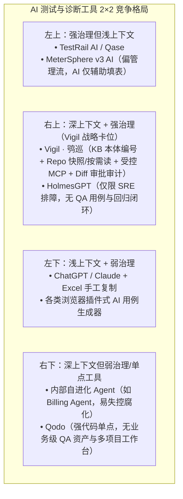

# Vigil · 鸮巡 — 市场调研、竞品分析与功能方向优化

> 调研日期：2026-11-21（Asia/Shanghai）
> 方法论来源：基于 `FlowFlex/.claude/skills/market-research`（定性/定量综合、痛点三角验证、行为画像、机会评分矩阵）与 `FlowFlex/.claude/skills/competitor-analysis`（多层竞争格局、2×2 定位图、买家视角能力矩阵、趋势信号与战略响应）。
> 调研目的：在 `workbench-core`、`knowledge-base`、`repo-integration` 三大底座基本成型后，梳理 2025–2026 业内 AI 测试与诊断工具的真实做法与踩坑教训，校准后续 6 大业务入口与 4 项平台扩展的功能方向。

---

## 一、市场调研综合（Market & User Research Synthesis）

### 1. 业内三大核心痛点（陈述偏好 vs. 真实行为）

通过对业内 QA 团队、研发自测与 SRE 排障实践的交叉梳理，AI 测试工具存在明显**「嘴上要的（Stated Preference）」与「实际用的（Revealed Behavior）」背离**：

| 维度 | 用户嘴上说的（Stated） | 真实发生的行为（Behavioral Signal） | 对 Vigil 的启示 |
|---|---|---|---|
| **AI 生成用例** | “给我一键从 PRD 生成 100 条测试用例” | 纯靠 PRD 裸生成的用例 **70% 以上是正确的废话或幻觉**（漏掉历史业务规则、接口字段约束和状态机流转）；测试同学删改耗时超过手写，用两次就弃用，退回 Excel / XMind | **无业务本体（KB）和代码契约（Repo）锚定的生成毫无价值**；生成结果必须是「绑定了 `BR-/ST-/API-` 编号的结构化测试设计矩阵」，而非大段自由聊天文本 |
| **AI 排查 Bug / 日志 / SQL** | “把报错日志贴给 AI 直接告诉我怎么改” | 单纯贴日志给 ChatGPT 只能得到通用猜测；真正能定位根因的团队都在用 **堆栈路径 → 自动拉对应 Commit 源码 + 数据库表结构/EXPLAIN** 的多源证据比对 | 必须打通已建好的 **`repo-integration`（按堆栈路径自动 `read_file`）** 与 **`knowledge-base`（`ENT-` 表结构 / `BR-` 规则）**，走「假设 → 证据 → 根因」结构化收敛 |
| **AI 挑回归用例** | “发版前让 AI 帮我挑一下回归清单” | 大模型根本不知道改了哪几行代码会影响哪些老功能；业内甚至出现「Agent 写 PR 改了 A 文件，把 3 层调用外的 B 业务搞崩而无人察觉」的高频事故 | **回归挑选不能靠 LLM 拍脑袋**，必须先走**确定性爆炸半径（Blast Radius）召回**：`Git Commit Diff 文件路径` → `KB 条目的 codePaths 与一跳邻居` → `关联历史用例与历史缺陷`，再由 LLM 做风险排序与漏测补充 |

---

### 2. 核心用户画像（按「人在场深潜」与「少确认批处理」双轨划分）

拒绝人口统计学画像，按**真实工作流行为模式**切分三类核心人群：

#### 画像 A：业务测试主力（功能 / 接口 QA）— 高频「人在场交互深潜」
- **核心任务（JTBD）**：需求评审后快速产出高覆盖度用例，不漏隐性老规则；兼容团队现有的 XMind / Excel 评审习惯。
- **当前痛点**：老系统潜规则散落在口口相传中；每次用通用 AI 都要重新贴一遍背景；生成的用例没有等价类/边界值结构。
- **Vigil 价值锚点**：勾选项目 `KnowledgeBase` 条目（`BR-` / `ST-` / `API-`）+ 按 `QA Skill` 规范生成结构化用例草稿 → 会话内交互追问微调 → 一键审批入库或导出 XMind / CSV。

#### 画像 B：研发排障与自测主力（后端 / 全栈 Dev & SDET）— 「人在场快速定位 + 少废话证据链」
- **核心任务（JTBD）**：线上/测试环境出报错日志、慢 SQL 或诡异 Bug 时，5 分钟内锁定是哪次 Commit、哪条 SQL 或哪条业务规则冲突引起的。
- **当前痛点**：在日志平台、云效/GitHub 代码仓、数据库客户端和 AI 聊天窗口之间来回复制粘贴。
- **Vigil 价值锚点**：贴入堆栈/慢 SQL → 自动关联 `repo-integration` 对应分支源码与 `KB` 实体表结构（后续叠加 `MCP` 只读查库/日志）→ 输出带代码行号与规则编号引用的 `Finding` 诊断卡。

#### 画像 C：版本把关者（QA Lead / 发布负责人）— 「少确认批处理 + 强审计把关」
- **核心任务（JTBD）**：发版前看清本次版本改动的影响面，确认回归范围无漏测，一键生成有据可查的准出测试报告，管住团队测试规范不腐化。
- **当前痛点**：不知道研发偷偷改了哪些底层文件；测试报告全靠手工拼凑数字；团队 Prompt 各自为政。
- **Vigil 价值锚点**：给定版本分支/Commit 范围 → 自动算出影响面回归清单（`regression-list`）→ 汇总执行结果与诊断结论出准出报告（`test-report`）→ 在审批中心（`approvals`）与变更审计（`asset-history`）统一把关 `QA Skill` 演进。

---

## 二、竞品全景与深度对比（Competitive Analysis）

### 1. 四层竞争格局（Competitive Set）

1. **直接竞品（AI 增强型测试管理与工作台）**
   - **MeterSphere v3（飞致云，开源+企业版）**：国内普及率最高的一站式开源持续测试平台；v3 支持表单/脑图双视图写用例、Excel/XMind 导入导出、在线用例评审，并接入 AI 对话生成单条/批量功能与接口用例 [27, 28, 30]。**短板**：AI 生成与底层代码仓、结构化业务本体割裂，主要停留在“根据自然语言描述或单接口文档生用例”。
   - **Apifox（AI 接口用例）**：国内接口研发测试标杆，支持基于 OpenAPI/接口契约一键用 AI 生成正向、边界、异常与安全测试用例 [31]。**短板**：强绑定 API 调试，缺乏业务规则图谱、日志/SQL 诊断与跨模块回归影响面分析。
   - **Qase（AIDEN）/ TestRail AI / QA Sphere**：海外主流轻量级用例管理平台，主打从需求描述生用例、手工测试转自动化脚本、测试运行摘要 [11, 12]。**短板**：纯 SaaS 黑盒、无本地代码仓只读深耦合、无统一业务本体索引。
2. **间接/代码感知型竞品（Code-Aware Testing & Autonomous QA Agents）**
   - **Qodo（原 CodiumAI：Qodo Gen / Cover / Merge）**：深度绑定代码上下文与 PR Diff，分析代码变更的爆炸半径并补充单元/组件测试 [37, 38, 41]。**启发**：其“PR Diff → 影响面 → 补齐测试缺口”的思路极值得 `regression-list` 与 `test-case` 借鉴。
   - **Momentic / Octomind**：2025–2026 最火的 AI E2E 自动化测试 Agent，主打自动探索 Web/App、生成并自愈 Playwright 脚本 [15, 17]。**边界**：重度聚焦 UI 自动化脚本执行，不解决业务规则建模与后端日志/SQL 诊断。
   - **Launchable**：基于代码变更与历史测试结果做预测性回归测试挑选（Predictive Test Selection）。**短板**：依赖海量 CI 历史训练黑盒统计模型，缺乏白盒业务知识库（`codePaths` + 领域邻居）的可解释性。
3. **相邻竞品（AI 故障诊断与根因分析 Agent）**
   - **Sentry Seer / Datadog Bits AI**：结合报错堆栈、Trace、日志与关联代码仓 Commit 自动推理根因并给出修复方案 [21, 22, 24]。
   - **HolmesGPT（Robusta 开源，CNCF Sandbox）**：开源 AI SRE 根因分析标杆 [32, 33]，通过受控只读工具集（MCP / 数据源插件）拉取日志、数据库与配置做多步调查，输出证据化 RCA 报告。**启发**：完全印证了 Vigil「`diagnosis` 域 + 受控只读 `mcp-registry`」的技术路线。
4. **替代方案（Substitutes）**
   - **ChatGPT / Claude 网页 + Excel / XMind 手工搬运**：零部署成本，但上下文每次重置、密钥与私有代码外泄风险高、无审计留痕。
   - **企业内部自研开放式 Agent（如 Billing Agent）**：允许 Agent 在运行时自写 Python 工具和静默建 Skill，短期灵活但迅速陷入“多胞胎工具腐化、权限失控、不可回滚”。

---

### 2. 竞争定位图（2×2 Landscape Map）

以**「上下文耦合深度（仅自然语言/单文档 ↔ 业务本体 + 代码仓 + 外部现场证据）」**为横轴，以**「工程可控性与治理（无约束黑盒聊天 ↔ 强约束、Diff 审批、全链路可审计回滚）」**为纵轴：

**Vigil 的独特无人区（Unclaimed Position）**：
> **「懂业务本体（KB）与代码变更（Repo）的受控 AI 测试工作台」**——把*业务规则图谱（`knowledge-base`）*、*代码仓只读洞察（`repo-integration`）*、*方法论演进（`qa-skills` + `approvals`）* 拧成一条可解释、可追溯、可回滚的 QA 证据链。

---

### 3. 买家视角能力对比矩阵（Feature Comparison Matrix）

评级口径：`Strong`（行业标杆/深度差异化）、`Adequate`（可用但无壁垒）、`Weak`（仅浅层支持/局限大）、`Absent`（缺失）。

| 核心能力域（买家评估维度） | Vigil · 鸮巡（当前底座 + 规划） | MeterSphere v3 AI | Qase / TestRail AI | Qodo (CodiumAI) | HolmesGPT / Sentry Seer | 开放式自进化 Agent (如 Billing Agent) |
|---|---|---|---|---|---|---|
| **1. 上下文地基（为什么 AI 不说废话）** | | | | | | |
| 结构化业务本体（编号索引 + 一跳邻居 + `codePaths`） | **Strong**（已落地 `knowledge-base`） | Absent | Absent | Weak（仅代码 AST/RAG） | Absent | Weak（散乱 Markdown） |
| 代码仓只读元数据 + 按需单文件读取（云效/GitHub） | **Strong**（已落地 `repo-integration`） | Weak（主要拉测试脚本） | Absent | **Strong** | **Strong** | Adequate |
| **2. 用例生成与管理（`test-case`）** | | | | | | |
| 基于业务规则 + 接口/代码的抗幻觉用例生成 | **Strong（核心主攻）** | Weak（纯提示词生单条/批量） | Weak（纯需求文本生） | **Strong**（偏单元测试） | Absent | Adequate |
| 脑图 / 表格双视图 & XMind / Excel 互导 | **待补齐（规划优化项）** | **Strong** | Adequate | Absent | Absent | Absent |
| **3. 缺陷、日志与 SQL 诊断（`diagnosis`）** | | | | | | |
| 堆栈/日志 + 对应 Commit 源码联合根因分析 | **Strong（核心主攻）** | Absent | Absent | Adequate（偏 PR 审查） | **Strong** | Adequate |
| 慢 SQL / 异常 SQL 结合表结构与执行计划分析 | **Strong（核心主攻）** | Absent | Absent | Weak | Adequate | Adequate |
| **4. 回归测试挑选（`regression-list`）** | | | | | | |
| 代码变更 → 业务本体 → 候选用例白盒影响面召回 | **Strong（核心壁垒）** | Weak（手工勾选测试计划） | Weak | **Strong**（代码层） | Absent | Absent |
| **5. 报告与证据链（`test-report`）** | | | | | | |
| 聚合用例执行、回归范围与诊断结论的可溯源报告 | **Strong（规划中）** | **Strong**（执行统计强） | **Strong** | Weak | Weak（仅单次事故报告） | Weak |
| **6. 平台扩展与安全治理** | | | | | | |
| 对话式迭代测试规范（Chat 提 Diff + 审批落盘 + 回滚） | **Strong**（已立规划红线） | Absent | Absent | Weak（静态配置） | Absent | Weak（无审批易腐化） |
| 唯一模型网关、凭证加密掩码、SSRF 与双方言自托管 | **Strong**（已落地 `workbench-core`） | Adequate | Weak（纯云端 SaaS） | Weak | Adequate | Weak |

---

## 三、市场趋势识别与战略响应（Trends & Strategic Response）

| 趋势信号 | 驱动力与时间窗 | 对 Vigil 的战略响应 | 具体落点 |
|---|---|---|---|
| **1. 从「Prompt 聊天生用例」转向「Ontology + Code 锚定生成」**（强信号） | 纯文本生成幻觉率太高；加上 AI 写代码普及后，PR 跨文件隐性破坏激增 [19]，测试必须锚定真实代码路径与业务规则（现在 → 1 年） | **Lead（全力领跑）** | 利用已完成的 `KB`（含 `codePaths` 与 `neighbors`）+ `Repo`（分支/Commit/文件按需读）作为 6 大入口的强制上下文底座 |
| **2. 诊断工具「MCP 化 + 证据链假设树」**（强信号） | HolmesGPT、Sentry Seer、Datadog Bits 均采用「假设树 + 只读工具拉取日志/库表/代码证据」替代单轮问答 [21, 24, 33]（现在） | **Fast Follow（快速跟进）** | `diagnosis` 域把 Bug / 日志 / SQL 统一到 `Hypothesis → Evidence → Finding` 模型；外部数据源统一走只读 `mcp-registry` |
| **3. 测试资产与已有工具链（XMind / CSV / 工单）零摩擦互操作**（强信号） | MeterSphere v3 等证明国内 QA 团队离不开脑图评审和 XMind/Excel 导入导出 [27]；锁死在私有表单里的工具推广阻力极大（现在） | **Fast Follow（快速跟进）** | `test-case` 域立项时直接支持 **结构化表格 + 轻量树形/脑图预览 + CSV/Markdown/XMind(.xmind JSON) 导出** |
| **4. 全自动 UI 探索与自愈脚本 Agent（Momentic / Octomind）**（高热但偏离主航道） | 浏览器端 Playwright Agent 火热 [15, 17]，但重度依赖目标环境渲染、算力消耗大，且与业务规则/后端诊断分属不同赛道 | **Ignore / 明确边界** | Vigil **不做**内置浏览器录制与 UI 自愈执行器；聚焦「测试设计、代码/本体影响面推理、诊断与回归决策」大脑层 |

---

## 四、对 Vigil 功能方向的具体优化建议（Actionable Direction Optimizations）

结合我们**已经做完的底座能力**（`workbench-core` + `knowledge-base` + `repo-integration` + 4 项平台扩展规划），对接下来要开的业务域提出 **5 项关键方向优化**：

### 优化 1：打通「知识库 ↔ 代码仓 ↔ 下游入口」的黄金三角（底座能力变现）

目前 `KnowledgeEntry` 已经有 `codePaths`（关联代码路径）和 `neighbors`（一跳邻居编号），`repo-integration` 已经能同步目录树、Commit 并按需 `read_file`。**下游业务域绝不能退化成“不看 KB 和 Repo 的普通聊天窗口”**：
- **自动上下文推荐（Context Recommender）**：
  - 当用户在会话里粘贴一段需求、报错堆栈或选定一个仓库文件时，后端先做一次**零 LLM 成本的确定性匹配**：按文本中出现的术语/接口路径/代码文件名，自动命中本项目的 `KnowledgeEntry`（及其一跳邻居）和 `RepoMetadataSnapshot` 中的文件，在输入框上方弹出**「推荐注入的本体条目与代码文件（可一键勾选）」**。
  - 这既守住了“不静默超预算、人可勾选控制”的基座原则，又把“3 步内拿到高质量结果（BG-02）”落到了实处。

---

### 优化 2：`test-case`（用例库）— 从“生成文本”升级为“测试设计矩阵 + 双向资产绑锚”

吸取业内 AI 生用例“十条有七条废话、需求一改全作废”的教训，`test-case` 域优化为：
1. **两阶段生成法（Test Design First, Cases Second）**：
   - 第一步先基于注入的 `KB` 条目（`BR-` 业务规则、`ST-` 状态机、`API-` 接口）生成**测试设计检查点（测试维度：正向主链路 / 等价类与边界值 / 状态流转异常 / 幂等与并发 / 权限边界）**；
   - 用户确认或勾选检查点后，再展开生成标准结构化用例（前置条件、输入数据、操作步骤、预期结果、优先级）。
2. **每条用例强制携带「溯源锚点（Traceability Anchors）」**：
   - `TestCase` 实体新增 `linkedKbCodes`（关联的知识库编号数组，如 `["BR-012", "API-004"]`）与 `linkedCodePaths`（关联代码路径前缀）。
   - **直接收益**：当知识库导入新版本提示某条 `BR-012` 发生内容变更，或仓库某文件变更时，能**立刻标红受影响的存量用例（Stale Case Detection）**，并为 `regression-list` 提供精确召回索引！
3. **贴合国内 QA 习惯的视图与导出**：
   - 支持按模块/标签的**表格视图 + 层级大纲（类脑图树）视图**切换；
   - 原生支持导出 `Markdown`、`CSV`（兼容 Excel / MeterSphere / Jira 导入）及标准结构化 JSON。

---

### 优化 3：`diagnosis`（分析 Bug / 排查日志 / 分析 SQL）— 统一为「多源证据链 + 假设检验」引擎

参照 Sentry Seer 与 HolmesGPT 的最佳实践，避免把三个入口做成三个互不相通的 Prompt 表单：
1. **统一诊断内核（`DiagnosisSession` → `Hypothesis` → `Evidence` → `Finding`）**：
   - 无论是分析 Bug、排查日志还是分析 SQL，AI 输出必须结构化为：
     - **观测事实（Observed Signals）**：从上传的 `.log` / `.sql` / 报错文本中提取的关键异常行、错误码、慢查询耗时；
     - **关联上下文（Correlated Context）**：通过 `repo-integration` 按堆栈文件路径自动拉取的源码片段（标注 `ref` 与行号），或通过 `knowledge-base` 命中的 `ENT-` 表定义 / `BR-` 业务规则；
     - **根因假设排序（Ranked Hypotheses）**：置信度（高/中/低）、支持证据、排除证据、下一步验证建议（例如建议执行的只读诊断 SQL 或日志过滤命令）；
     - **确认结论（Confirmed Finding）**：人工点“采纳为结论”后落库为 `Finding`，记录**受影响模块 / 关联 `kbCodes` / 关联 `codePaths` / 回归建议**（直接供 `regression-list` 与 `test-report` 消费）。
2. **分析 SQL 入口的专属增强**：
   - 支持同时粘贴 **SQL 语句 + `EXPLAIN` 输出 + 表结构 DDL（或直接勾选知识库 `ENT-` 实体）**；
   - 结合项目的双方言或目标数据库类型（从 `ProjectContext.techStack` 读取），专项检查索引失效、隐式类型转换、深分页、大事务锁竞争与 N+1 模式。

---

### 优化 4：`regression-list`（生成回归清单）— 打造「确定性图谱召回 + AI 风险排序」杀手级功能

这是市面上几乎所有开源测试平台（包括 MeterSphere v3）的空白区，也是 Vigil 底座设计最能发挥威力的地方：
1. **三路确定性信号召回（Deterministic Blast-Radius Recall）**：
   - **信号 1（代码变更）**：从 `repo-integration` 选择两个分支或 Commit，识别变更文件列表 → 匹配 `KnowledgeEntry.codePaths` 与 `TestCase.linkedCodePaths`；
   - **信号 2（本体图谱扩散）**：将命中的 `KnowledgeEntry` 沿 `neighbors`（一跳邻居）扩散，找出上下游关联的业务规则 `BR-` 与状态 `ST-`，召回关联用例；
   - **信号 3（缺陷影响面）**：读取 `diagnosis` 域在本项目下近期产出的 `Finding` 受影响模块与关联编号。
2. **AI 风险排序与「漏测缺口提醒（Coverage Gap Alert）」**：
   - 将三路召回的候选用例交给 `AiGateway.complete`，按**变更风险等级（P0 必测 / P1 建议测 / P2 抽测）**排序并附上「为什么选这条（命中了哪条代码/规则/缺陷）」的可解释理由；
   - 若某个变更代码路径或新增业务规则**没有任何存量用例覆盖**，显式输出**「发现回归盲区：建议前往 `test-case` 补齐该场景用例」**并支持一键带上下文跳转。

---

### 优化 5：支持「人在场单人深潜」与「少确认批处理」双工作流模式

结合不同使用场景，将 6 大入口的交互统一为两种可切换节奏：

| 维度 | 模式 A：人在场单人深潜（Interactive Mode） | 模式 B：少确认批处理流转（Batch / Triage Mode） |
|---|---|---|
| **适用场景** | 复杂核心需求写用例、疑难线上 Bug 联合排障、微调 `QA Skill` | 版本发版前按 Commit 批量出回归清单 + 缺口用例提案、批量日志初筛 |
| **上下文供给** | 系统自动推荐 `KB` 条目与 `Repo` 文件，人在界面勾选确认并多轮追问 | 按预设 `QA Skill` 规则与 Commit / 模块范围自动组装上下文（遵守 200,000 字符硬预算） |
| **人工确认节点** | 会话内步步可见（先确认测试设计点，再展开用例；先看假设，再采纳 Finding） | 中间过程自动跑完，最终产出一次性汇入**审批中心（`Approvals`）**或会话汇总卡，人做一次终审拍板 |

---

## 五、机会评分矩阵与推荐立项排期（Opportunity Scoring & Roadmap Optimization）

按 `market-research` 技能的机会评分公式（**Impact** 1–5 × **Evidence Strength** 1–5 × **Strategic Alignment** 1–5 × **Feasibility** 1–5，满分 5.0 加权）对后续模块重排优先级：

| 排序 | 待立项域 / 能力 | 痛点影响 (Impact) | 证据强度 (Evidence) | 战略契合 (Alignment) | 落地可行性 (Feasibility) | 综合得分 | 推荐节奏与理由 |
|---|---|---|---|---|---|---|---|
| **1** | **`test-case`（用例库）+ `qa-skills` 最小闭环（v0 + Chat Diff 审批）** | 5.0 | 5.0 | 5.0 | 4.5 | **4.9** | **第一优先级立项**。QA 最高频刚需入口；直接消费 `KB` + `Repo`；同时带出 `qa-skills` / `approvals` 轻量版，验证资产演进闭环；且为 `regression-list` 沉淀带锚点的用例库 |
| **2** | **`diagnosis`（Bug / 日志 / SQL 三合一诊断）** | 5.0 | 4.5 | 5.0 | 4.5 | **4.8** | **第二优先级立项**。直接把 `repo-integration` 的 `read_file` 与 `KB` 的 `ENT-/BR-` 变成排障生产力；无需等外部 MCP 即可先靠「上传制品 + 代码仓按需读 + 知识库」跑通 V1 |
| **3** | **`regression-list`（生成回归清单）** | 4.5 | 4.5 | 5.0 | 4.5 | **4.6** | **第三优先级立项**。依赖 `test-case` 的存量用例锚点与 `diagnosis` 的 `Finding` 影响面，一旦前两者就位，即可打出最具差异化的「代码+本体爆炸半径召回」 |
| **4** | **`test-report`（生成测试报告）** | 4.0 | 4.5 | 4.5 | 5.0 | **4.5** | **第四优先级立项**。自然消费 `test-case` 执行记录、`regression-list` 覆盖度与 `diagnosis` 结论，实现难度最低、收口全链路 |
| **5** | **`mcp-registry`（受控 MCP 工具源）** | 4.0 | 4.5 | 4.0 | 3.5 | **4.0** | **随 `diagnosis` V1.5 或独立跟进**。先让 `diagnosis` 跑通本地制品+Repo+KB，再通过只读 MCP 接入实时日志库与只读数据库，避免初期外部环境联调拖慢主线 |
| **6** | **`ontology-builder`（本体生成域）** | 4.0 | 3.5 | 4.5 | 3.5 | **3.9** | **压轴立项**。目前 `knowledge-base` 已支持标准 `index.json + .md` 导入，手工或外部脚本生成可先用着；等 6 大入口全部跑通后再内嵌可视化本体扫描与确认 |

---

## 六、参考来源（Primary Sources & Industry Benchmarks）

- [11, 12, 13] Test Case Management & AI Generation Benchmarks (QA Sphere, Qase AIDEN, TestRail AI, Figr 2026 Comparison)
- [15, 17] Autonomous E2E QA Agents: Momentic (`momentic.ai`) & Octomind (`bug0.com/knowledge-base/octomind-ai-testing-platform-features`)
- [21, 22, 24, 25] AI Incident & Bug Root Cause Analysis: Sentry Seer (`docs.sentry.io/product/ai-in-sentry/seer/`) & Datadog Bits Investigation (`rapdev.io/datadog-offering/ai`)
- [27, 28, 30, 31] 国内主流测试平台基准：MeterSphere v3 用例脑图/评审/AI 生成文档 (`metersphere.io/docs/v3.x/user_manual/test_case/intro/`) & Apifox AI 测试用例生成
- [32, 33, 34] 开源 SRE/诊断 Agent 基准：Robusta HolmesGPT (CNCF Sandbox, `github.com/robusta-dev/holmesgpt`)
- [37, 38, 41] 代码感知测试生成与 PR 影响面分析：Qodo Gen / Cover / Merge (`qodo.ai/glossary/what-is-ai-test-automation/`)
