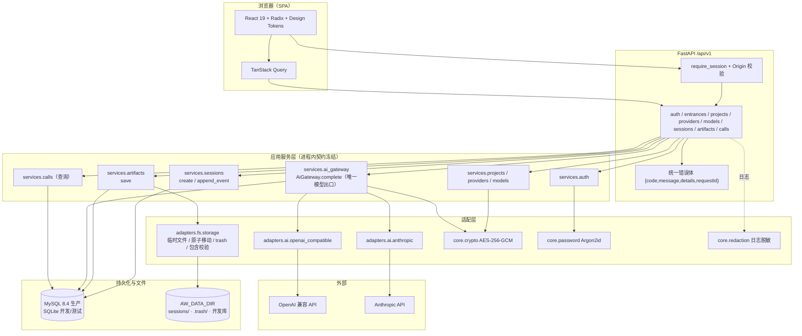
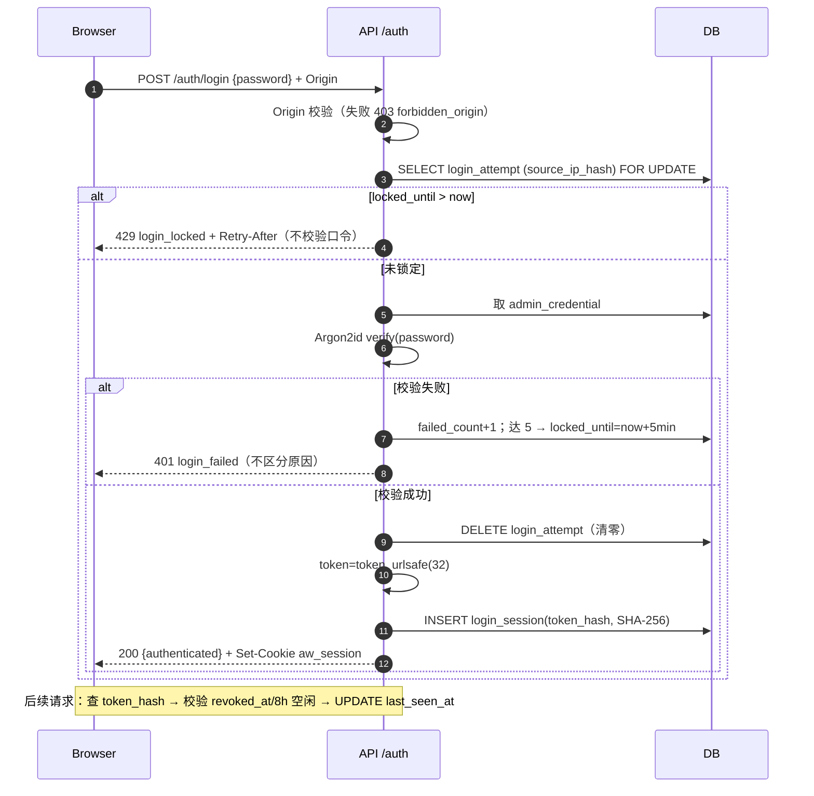
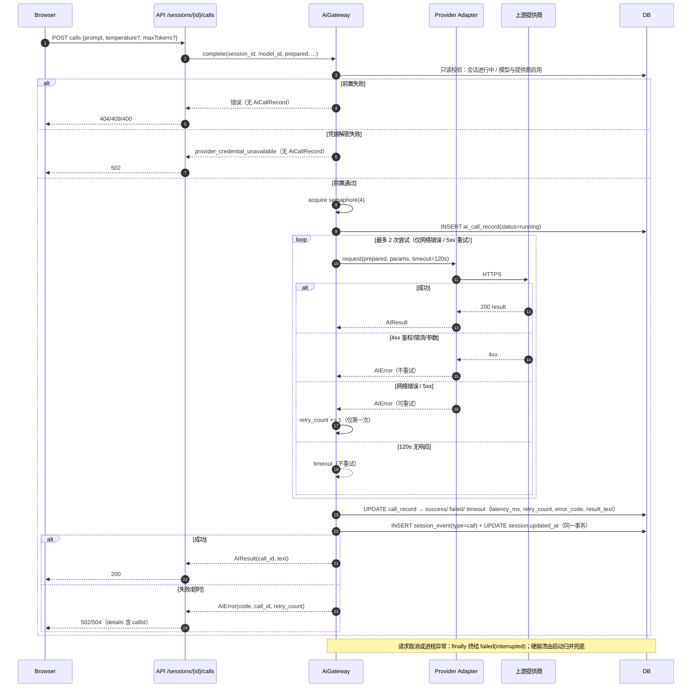
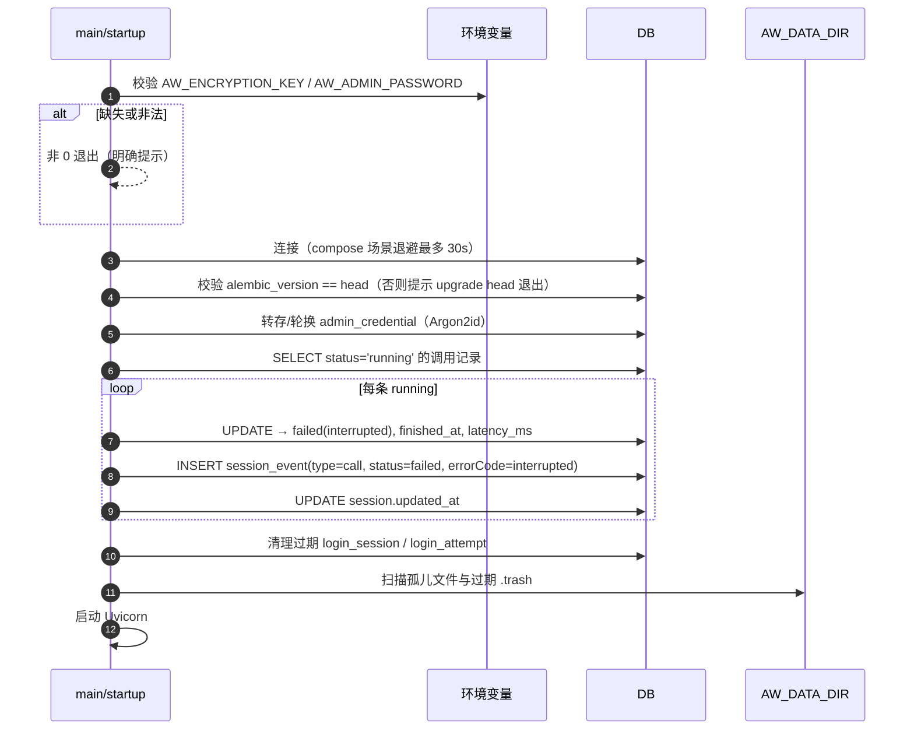
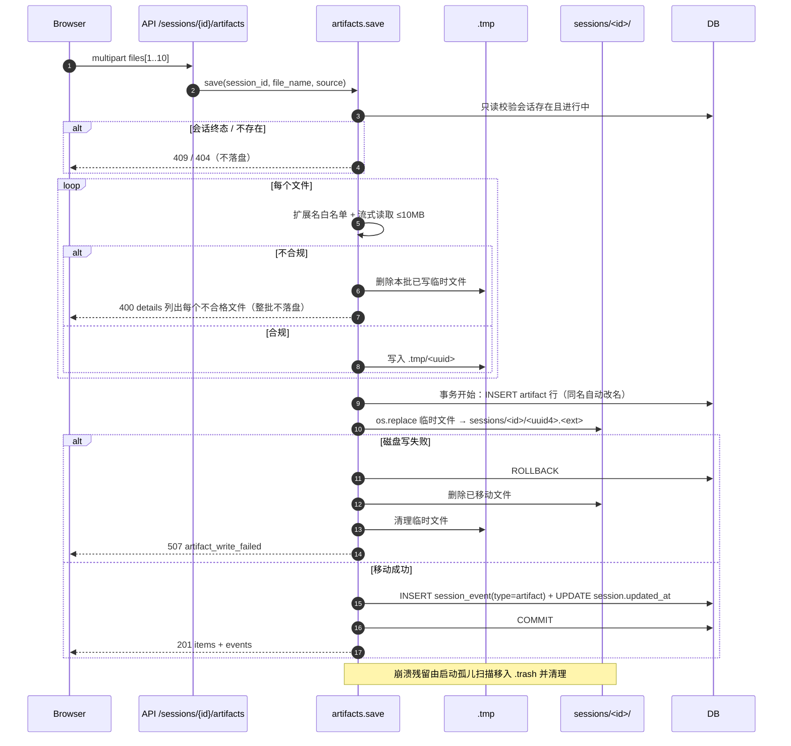
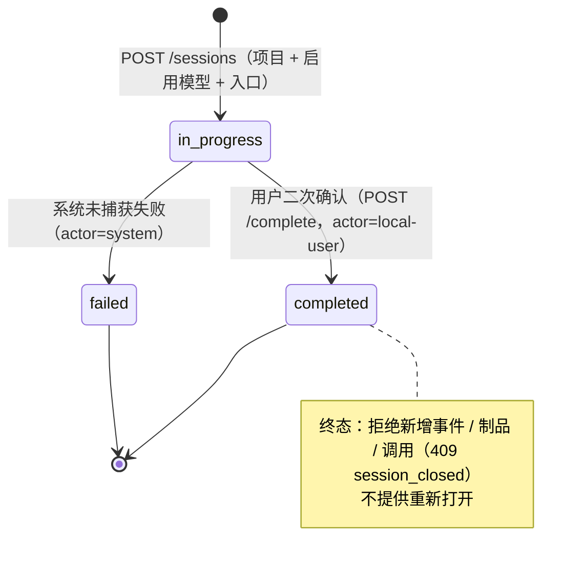
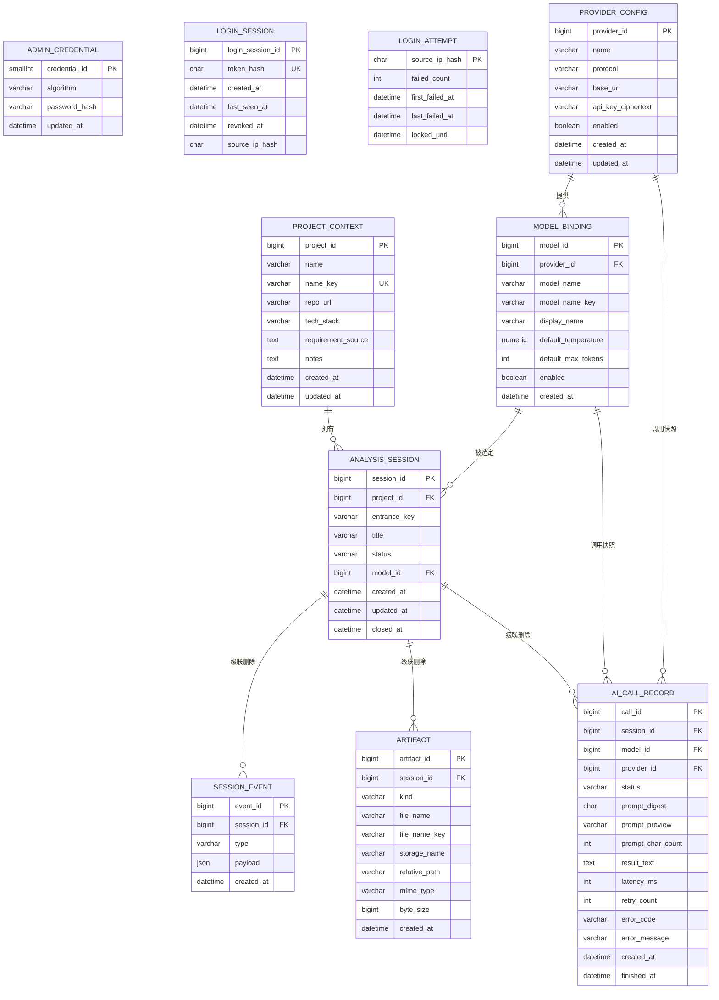

# Flowchart — workbench-core

> 阶段：tech-design。图与 `docs/database-schema.md` / `docs/api-spec.md` / `change-spec.md` 一致。

## 1. 分层架构



## 2. 登录与来源锁定



## 3. AI 调用（成功 / 重试 / 超时 / 中断）



## 4. 启动自检与 running 回收



## 5. 文件上传（校验、落盘、半成品清理）



## 6. 删除会话（DB + 文件一致性）

```mermaid
sequenceDiagram
  autonumber
  participant B as Browser
  participant API as API DELETE /sessions/{id}
  participant S as sessions.delete_session
  participant FS as AW_DATA_DIR
  participant DB as DB

  B->>API: DELETE /sessions/42（ConfirmDialog 已确认）
  API->>S: delete_session(42)
  S->>FS: rename sessions/42 → .trash/42-<uuid>
  alt 重命名失败
    S-->>B: 500 session_delete_failed（DB 不动）
  else 重命名成功或目录不存在
    S->>DB: BEGIN; DELETE analysis_session WHERE id=42
    Note over DB: CASCADE：session_event / artifact / ai_call_record
    alt 提交成功
      S->>FS: 删除 .trash/42-<uuid>（失败仅记日志）
      S-->>B: 204
    else 提交失败
      S->>FS: 尽力 rename 回 sessions/42
      S-->>B: 500 internal_error（trash 由清理任务兜底）
    end
  end
```

## 7. 会话状态流转



## 8. ER 图



> `ADMIN_CREDENTIAL`、`LOGIN_SESSION`、`LOGIN_ATTEMPT` 不与业务表建外键；登录会话独立于分析会话。
