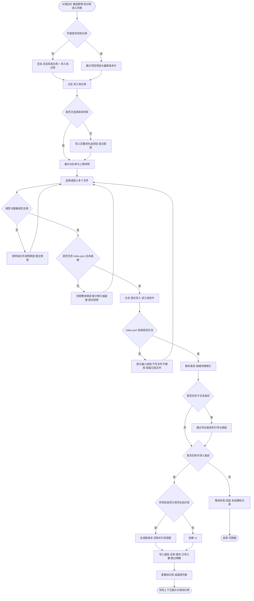
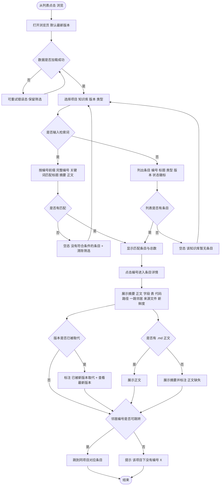
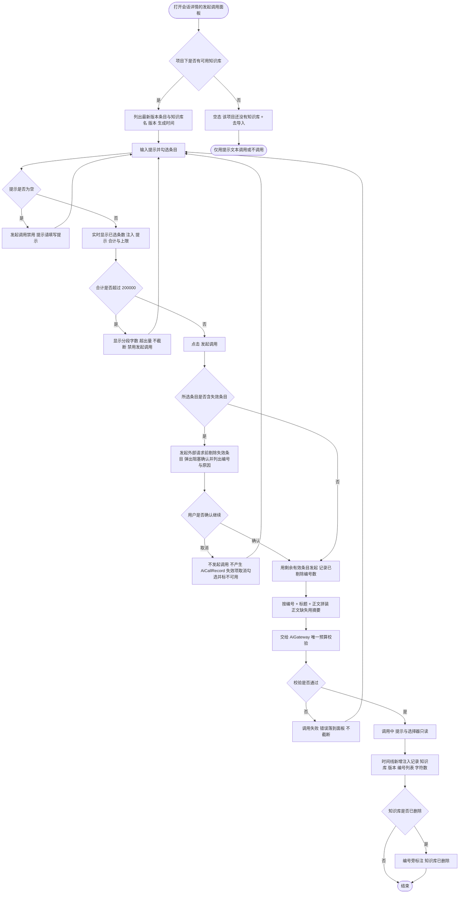
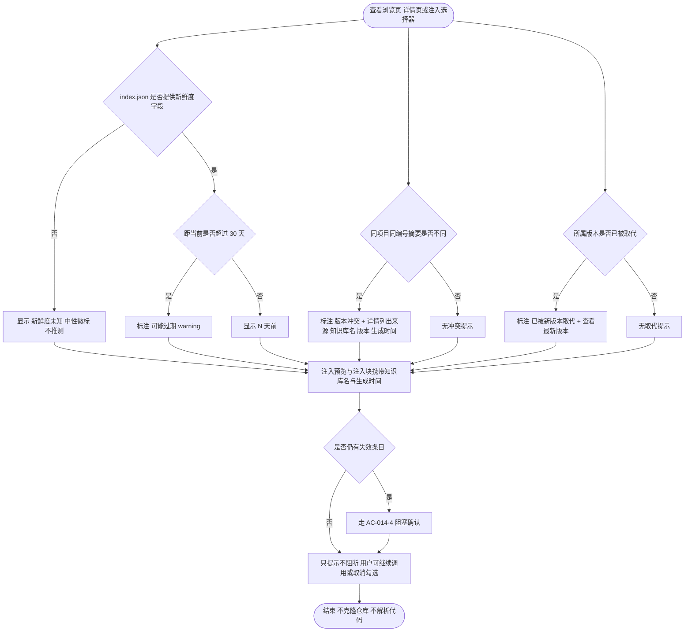
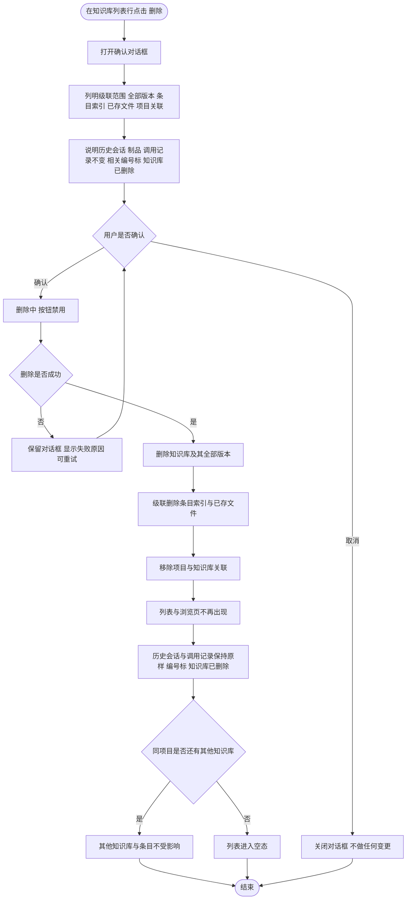

# Interaction Design — Flowchart

> 每个用户故事一张 Mermaid 用户操作流程图，对应 US-012 ~ US-016。US-014 按 2026-11-18 AMB-026 修正口径绘制：失效条目先剔除，再阻塞式确认，确认后继续 / 取消则不发起。

## US-012：导入知识库并建立编号索引

## US-013：浏览与检索知识库条目

## US-014：勾选编号注入调用上下文

## US-015：识别知识库新鲜度与版本冲突

## US-016：删除知识库

## demo 页面与路由映射

| 流程图 | demo 页面 | 路由 |
|--------|-----------|------|
| US-012 | `#list` / `#import` | `/knowledge-bases` / `/knowledge-bases/import` |
| US-013 | `#browse` / `#detail` | `/knowledge-bases/:kbId` / `/knowledge-bases/:kbId/entries/:code` |
| US-014 | `#inject` + 失效确认对话框 | `/sessions/:id`（core 内嵌） |
| US-015 | `#browse` / `#detail` / `#inject` 徽标与冲突卡 | 同上 |
| US-016 | `#list` + 删除确认对话框 | `/knowledge-bases` |
