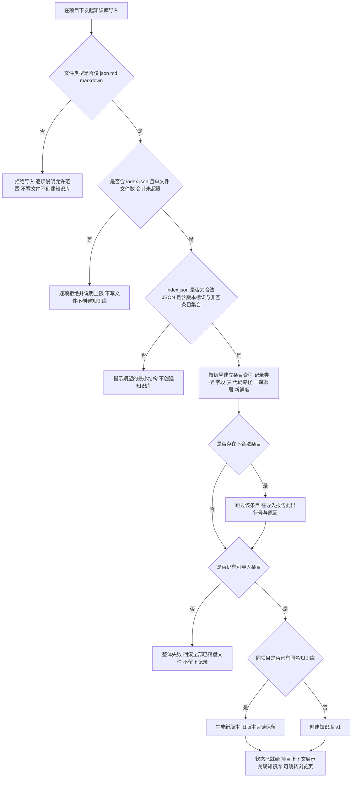
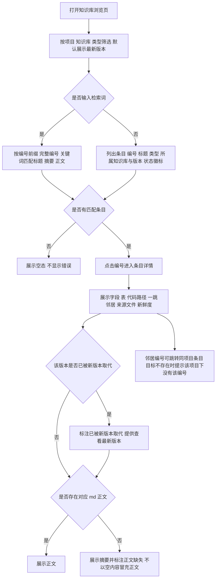
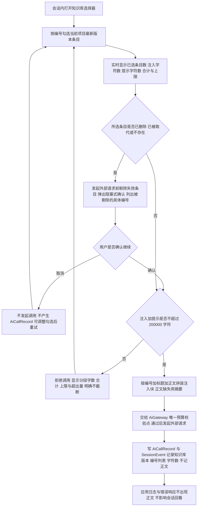
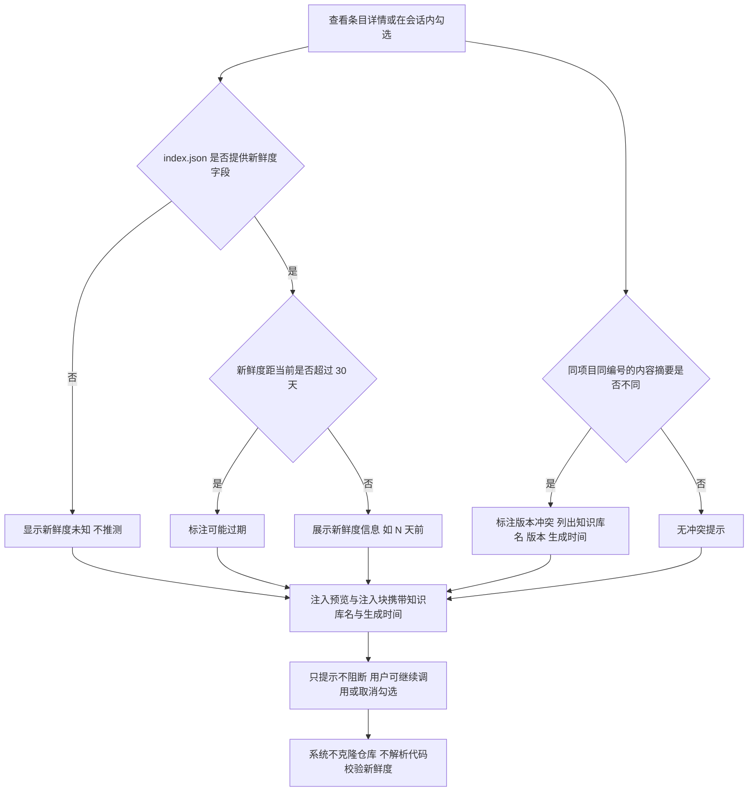
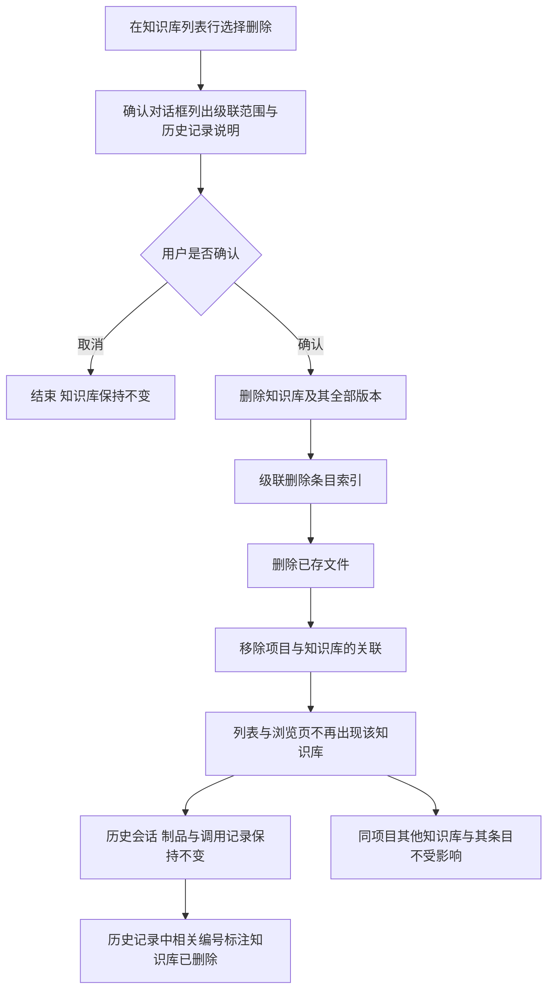

# Requirements Analysis — Flowchart

> 每个用户故事一张图，对应 US-012 ~ US-016。US-014 的「失效条目」分支按 2026-11-18 AMB-026 修正口径绘制（剔除失效条目 + 阻塞式确认后继续），与修订后的 AC-014-4 一致。

## US-012：导入知识库并建立编号索引

## US-013：浏览与检索知识库条目

## US-014：勾选编号注入调用上下文

## US-015：识别知识库新鲜度与版本冲突

## US-016：删除知识库

