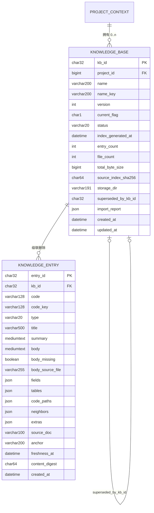

# Database Schema — knowledge-base

> 阶段：tech-design（步骤 5，`data=yes`）。上游：`technical-design/docs/architecture-decisions.md`（ADR-103 / ADR-104 / ADR-105 / ADR-106 / ADR-116 / ADR-117，`architecture-locked`）、`requirements-analysis/docs/context.md`。
> 生产 MySQL 8.4 LTS（InnoDB / utf8mb4 / `utf8mb4_0900_ai_ci`）；开发与默认测试 SQLite（aiosqlite）。**本 spec 只新增 2 张表，不改 core 的 10 张表**；`ai_call_record` 的知识库列与 `session_event.type` 扩展由 core 的迁移 `0006` 落地（ADR-111），本 spec 不建外键指向 `knowledge_base`。

## 实体关系图



> `project_context` 属于 core，`project_id` 为其 `BigInteger` 主键（SQLite 侧 `INTEGER`）。`ai_call_record` / `session_event` 不在本图内：它们只存 `kbId` 与编号快照，**无外键**，删除知识库后历史记录保持不变（AC-016-2）。

## 1. 通用约定（继承 core，1:1 复用）

| 约定 | 写法 | 说明 |
|------|------|------|
| 主键（知识库侧） | `CHAR(32)`，服务端 `uuid4().hex` | 对外 API 与进程内签名均为 `str`，与 core 的 BigInt 主键不同（ADR-103） |
| 外键到 core | `BigInteger().with_variant(Integer, "sqlite")` | 与 `project_context.project_id` 同型；`ON DELETE RESTRICT` |
| 时间 | `DateTime()`（应用写 UTC naive） | MySQL `DATETIME(6)`；禁 `NOW()` / `CURRENT_TIMESTAMP` |
| 布尔 | `Boolean` | MySQL `TINYINT(1)`，SQLite 0/1 |
| JSON | `sa.JSON` | `import_report`、`fields` / `tables` / `code_paths` / `neighbors` / `extras`；不建索引、不做 `JSON_EXTRACT` |
| 长文本 | `Text().with_variant(MEDIUMTEXT(), "mysql")` | `summary` / `body`；单文件 ≤10MB，远小于 16MB |
| 哈希列 | `CHAR(64)` | `source_index_sha256` / `content_digest` |
| 被索引字符串 | `VARCHAR(≤191)` | `name_key` 200 字符在 utf8mb4 下 800 字节，另加 `project_id` 8 字节仍 <3072 |
| 大小写归一 | `*_key` 存 Python `casefold()` 结果 | 不依赖列 collation（MySQL `ai_ci` vs SQLite `BINARY`） |
| 表参数 | `{"mysql_engine": "InnoDB", "mysql_charset": "utf8mb4", "mysql_collate": "utf8mb4_0900_ai_ci"}` | Alembic `op.create_table` 显式声明 |
| 约束命名 | `pk_` / `fk_` / `uq_` / `ix_` / `ck_` + 表名 + 列名 | 沿用 core `naming_convention` |
| CHECK | 枚举列全部加 `CheckConstraint` | `status` / `type` / `current_flag` |
| 外键开关 | SQLite 连接建立时 `PRAGMA foreign_keys=ON` | 由 core `db/engine.py` 的连接事件统一执行，本 spec 不重复实现 |

**禁止**：方言专属 DDL、partial index、生成列、`ON DUPLICATE KEY`、`INSERT OR REPLACE`、对 JSON 列建索引、把客户端文件名拼进路径。

## 2. 表结构

### 2.1 `knowledge_base`（一行 = 一个版本快照）

| 列 | 类型 | 可空 | 默认 | 约束 / 说明 |
|----|------|------|------|-------------|
| `kb_id` | `CHAR(32)` | 否 | — | PK `pk_knowledge_base`；uuid4 hex |
| `project_id` | `BigInteger`（SQLite `Integer`） | 否 | — | FK `fk_knowledge_base_project_id` → `project_context.project_id` `ON DELETE RESTRICT`；归属项目（BR-C16） |
| `name` | `VARCHAR(200)` | 否 | — | 展示名，按 ADR-104 六级推导；trim 后 ≤200 |
| `name_key` | `VARCHAR(200)` | 否 | — | `casefold(trim(name))`，项目内唯一性依据 |
| `version` | `Integer` | 否 | — | 同名逻辑库从 1 起，`max+1` |
| `current_flag` | `CHAR(1)` | 是 | `NULL` | 当前版本 `'1'`，历史版本 `NULL`；`ck_knowledge_base_current_flag`：`current_flag IS NULL OR current_flag = '1'` |
| `status` | `VARCHAR(20)` | 否 | `'ready'` | `ck_knowledge_base_status`：`ready` / `superseded`（导入失败不落库，无 `failed` 行） |
| `index_generated_at` | `DateTime` | 是 | `NULL` | 来自 `index.json` 的 `meta.source.exported_at` / 顶层 `generated_at`；缺失即「未知」，不推断 |
| `entry_count` | `Integer` | 否 | `0` | 成功入库条目数 |
| `file_count` | `Integer` | 否 | `0` | 本次上传文件数（含 `index.json` 与未匹配 md） |
| `total_byte_size` | `BigInteger` | 否 | `0` | 本次上传文件实际字节合计 ≤100MB |
| `source_index_sha256` | `CHAR(64)` | 否 | — | `index.json` 原文 SHA-256 |
| `storage_dir` | `VARCHAR(191)` | 否 | — | 相对 `AW_DATA_DIR`，固定 `knowledge-bases/<kbId>` |
| `superseded_by_kb_id` | `CHAR(32)` | 是 | `NULL` | 指向新版本 `kb_id`；**不建外键**（删除逻辑库时一次删全部版本，自引用 FK 会阻塞级联） |
| `import_report` | `JSON` | 是 | `NULL` | 固定枚举原因与计数，不含正文（ADR-106 / ADR-114） |
| `created_at` / `updated_at` | `DateTime` | 否 | — | 应用层写 UTC |

索引与唯一约束：

| 名称 | 类型 | 列 | 用途 |
|------|------|----|------|
| `uq_knowledge_base_project_name_current` | UNIQUE | (`project_id`, `name_key`, `current_flag`) | 同项目同名**同时只有一个当前版本**；两方言都允许多个 `NULL` |
| `uq_knowledge_base_project_name_version` | UNIQUE | (`project_id`, `name_key`, `version`) | 防版本重号（并发保护） |
| `ix_knowledge_base_project_current` | INDEX | (`project_id`, `current_flag`) | 列表与「当前版本」查询主路径 |
| `ix_knowledge_base_project_name` | INDEX | (`project_id`, `name_key`) | 版本链与冲突查询 |

### 2.2 `knowledge_entry`（一行 = 一个编号）

| 列 | 类型 | 可空 | 默认 | 约束 / 说明 |
|----|------|------|------|-------------|
| `entry_id` | `CHAR(32)` | 否 | — | PK `pk_knowledge_entry`；uuid4 hex |
| `kb_id` | `CHAR(32)` | 否 | — | FK `fk_knowledge_entry_kb_id` → `knowledge_base.kb_id` `ON DELETE CASCADE` |
| `code` | `VARCHAR(128)` | 否 | — | 编号原文（如 `ENT-123`），≤128 |
| `code_key` | `VARCHAR(128)` | 否 | — | `casefold(code)`；库内唯一 |
| `type` | `VARCHAR(20)` | 否 | — | `ck_knowledge_entry_type`：`term` / `entity` / `state` / `rule` / `process` / `api` / `domain_event` / `other`；由前缀映射，不信任条目自带 `type` |
| `title` | `VARCHAR(500)` | 否 | — | `zh_name` 优先，否则 `name`；缺失时用编号兜底 |
| `summary` | `MEDIUMTEXT`（SQLite `TEXT`） | 否 | `''` | `zh_definition` → `description` → `content`；不截断 |
| `body` | `MEDIUMTEXT`（SQLite `TEXT`） | 是 | `NULL` | 只来自上传的 `.md`；缺失为 `NULL` |
| `body_missing` | `Boolean` | 否 | `true` | 正文去首尾空白后为空即 `true` |
| `body_source_file` | `VARCHAR(255)` | 是 | `NULL` | 命中的 `.md` 原始文件名（仅展示） |
| `fields` | `JSON` | 是 | `NULL` | 对象；类型不符跳过该条 |
| `tables` | `JSON` | 是 | `NULL` | 字符串数组 |
| `code_paths` | `JSON` | 是 | `NULL` | 字符串数组 |
| `neighbors` | `JSON` | 是 | `NULL` | `[{id, relation, relation_name, dir}]`，最多 200 条 |
| `extras` | `JSON` | 是 | `NULL` | 未建模键；规范 JSON >64KB 丢弃并记报告 |
| `source_doc` | `VARCHAR(100)` | 是 | `NULL` | 上游溯源 |
| `anchor` | `VARCHAR(200)` | 是 | `NULL` | 上游溯源 |
| `freshness_at` | `DateTime` | 是 | `NULL` | 缺失 = 未知；早于 `now - 30d` = 可能过期 |
| `content_digest` | `CHAR(64)` | 否 | — | `sha256(归一化摘要)`；冲突判定（ADR-116） |
| `created_at` | `DateTime` | 否 | — | 入库顺序依据 |

索引与唯一约束：

| 名称 | 类型 | 列 | 用途 |
|------|------|----|------|
| `uq_knowledge_entry_kb_code` | UNIQUE | (`kb_id`, `code_key`) | 库内编号唯一；导入时重复保留首条 |
| `ix_knowledge_entry_code_key` | INDEX | (`code_key`) | 全局检索的编号精确/前缀命中、冲突批量查询 |
| `ix_knowledge_entry_kb_type` | INDEX | (`kb_id`, `type`) | 类型分栏与库内浏览 |

## 3. 完整性、级联与删除口径

- `ProjectContext 1 ─ n KnowledgeBase 1 ─ n KnowledgeEntry`；删除项目被 `RESTRICT` 阻止（core 不提供项目删除接口）。
- 删除知识库 = 删除**逻辑库**（`project_id + name_key` 命中的全部版本）：单事务删 `knowledge_base` 行，`knowledge_entry` 由 `ON DELETE CASCADE` 跟随；提交后把各版本目录 `rename` 进 `AW_DATA_DIR/.trash/<kbId>-<ts>/`，失败只记日志（ADR-117）。
- 历史 `session_event` / `ai_call_record` / 制品**不修改**：它们没有指向 `knowledge_base` 的外键；读取时按快照 `kbId` 左连接判定 `kbDeleted`（表不存在或行不存在均为 `true`）。
- 备份恢复顺序：DB 快照 → `knowledge-bases/` 目录；恢复后用各库 `manifest.json` 核对 sha256。已删除库可能随 DB 快照「复活」，以 DB 快照为准。

## 4. 迁移策略

### 4.1 迁移链

```
0001_auth → 0002_project_provider_model → 0003_session_event
          → 0004_artifact → 0005_ai_call_record
          → 0006_knowledge_injection   (core 交付：ai_call_record 4 列 + session_event.type 扩展)
          → 0007_knowledge_base        (本 spec 交付：2 张新表)
```

- 文件：`migrations/versions/0007_knowledge_base.py`，`revision = "0007"`，`down_revision = "0006"`。
- 前置：core 的 `0006` 必须先落地；本 spec 的迁移**不引用** `ai_call_record` / `session_event`，因此两者可在代码层面并行开发，但发布顺序固定为 `0006` → `0007`。
- 本 spec 不改任何 core 表的列、约束与 CHECK；`0007` 只做两张新表的 `create_table`。

### 4.2 升级 / 降级

```python
def upgrade() -> None:
    op.create_table("knowledge_base", ...)     # 先父表
    op.create_table("knowledge_entry", ...)    # 后子表，含 FK ON DELETE CASCADE

def downgrade() -> None:
    op.drop_table("knowledge_entry")           # 先子表
    op.drop_table("knowledge_base")
```

- 新建表无需 `batch_alter_table`；不使用方言专属参数。`sa.JSON` 在 MySQL 为 `JSON`、SQLite 为 `TEXT`；`MEDIUMTEXT` 通过 `sa.Text().with_variant(mysql.MEDIUMTEXT(), "mysql")`。
- 自检：`tests/test_kb_migrations.py` 在 SQLite 临时文件库与 MySQL CI 容器上各跑一次 `upgrade head` → `downgrade 0006` → `upgrade head`，并断言两方言的索引与 CHECK 均存在、`ON DELETE CASCADE` 生效（RISK-021 / TC-144）。

### 4.3 双方言差异清单

| 差异点 | MySQL 8.4 | SQLite | 处理 |
|--------|-----------|--------|------|
| 大文本 | `TEXT` 仅 64KB，非严格模式静默截断 | `TEXT` 无限制 | 强制 `MEDIUMTEXT` 变体；用例断言 >64KB 正文完整读回（TC-145） |
| JSON | 原生 `JSON`，不能直接建索引 | `TEXT` 存 JSON | `sa.JSON`，只用整列读写，不建索引、不做 `JSON_EXTRACT` |
| 可空唯一 | 唯一索引允许多个 `NULL` | 同 | `current_flag` 用 `'1'` / `NULL`，不用 `'0'` |
| 大小写唯一 | 默认 `ai_ci` | 默认 `BINARY` | 唯一性落在 `name_key` / `code_key`（应用层 `casefold`） |
| 外键级联 | InnoDB 支持 | 需 `PRAGMA foreign_keys=ON` | 连接建立时统一开启（core `db/engine.py`） |
| LIKE | 列 collation 决定 ASCII 大小写不敏感 | 仅 ASCII 不敏感 | 查询串转义 `% _ \` + `ESCAPE '\'`；非 ASCII 拉丁大小写差异写入验收说明，不承诺一致 |
| 时间 | `DATETIME(6)` | ISO 文本 | 应用层写 UTC naive，禁数据库时间函数 |

## 5. 容量与性能边界

| 对象 | 预期量级 | 依据 / 说明 |
|------|---------|-------------|
| `knowledge_base` | 单项目 <10 行（含历史版本） | 每个逻辑库的版本链；同项目名称唯一 |
| `knowledge_entry` | 单库 ≤20,000 行，单项目当前版本 ≤50,000 行（升级门禁） | 解析护栏与 ADR-108 的 FTS 门禁 |
| 单行 `body` | ≤10MB（单文件上限隐含） | `MEDIUMTEXT` 16MB 余量 |
| 关键词检索 | 当前版本范围内 `LIKE '%q%'` 扫描；p95 >500ms 触发 FTS 升级 | ADR-108；接口与 `content_digest` 不变 |
| 冲突查询 | 按 `code_key IN (...)` 批量一次查询 | 不做逐行 N+1（ADR-116） |
