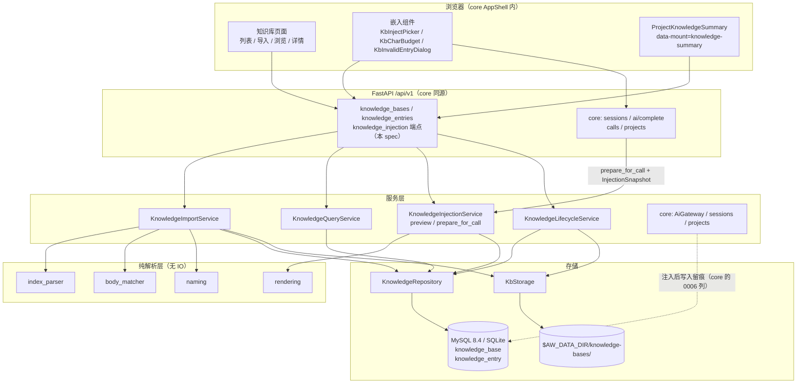
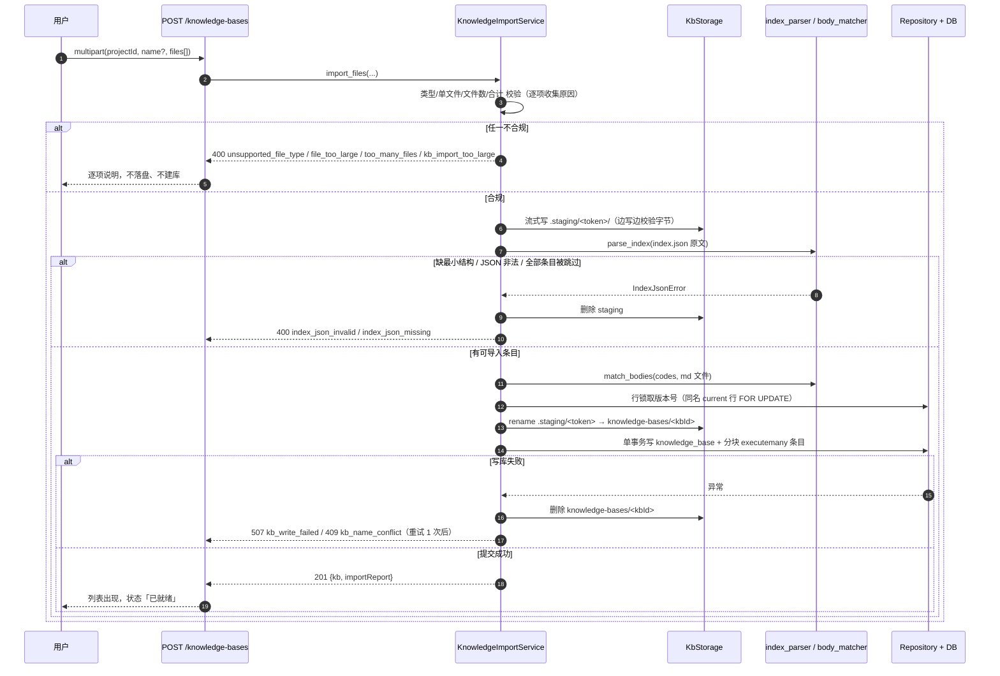
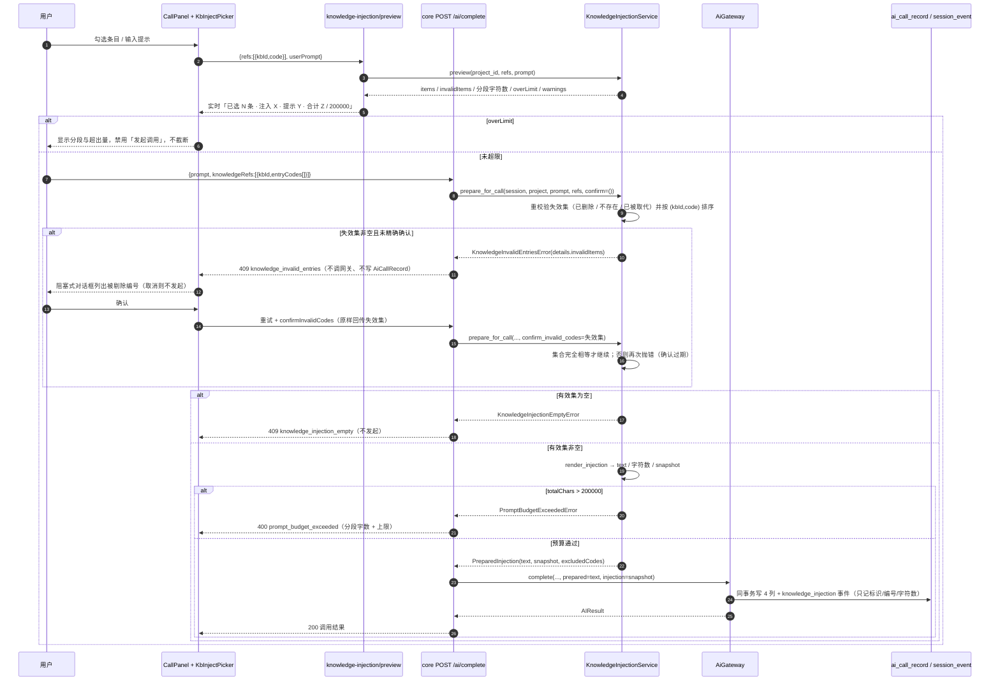
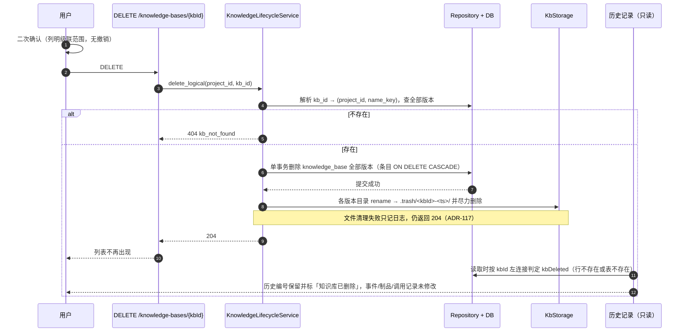
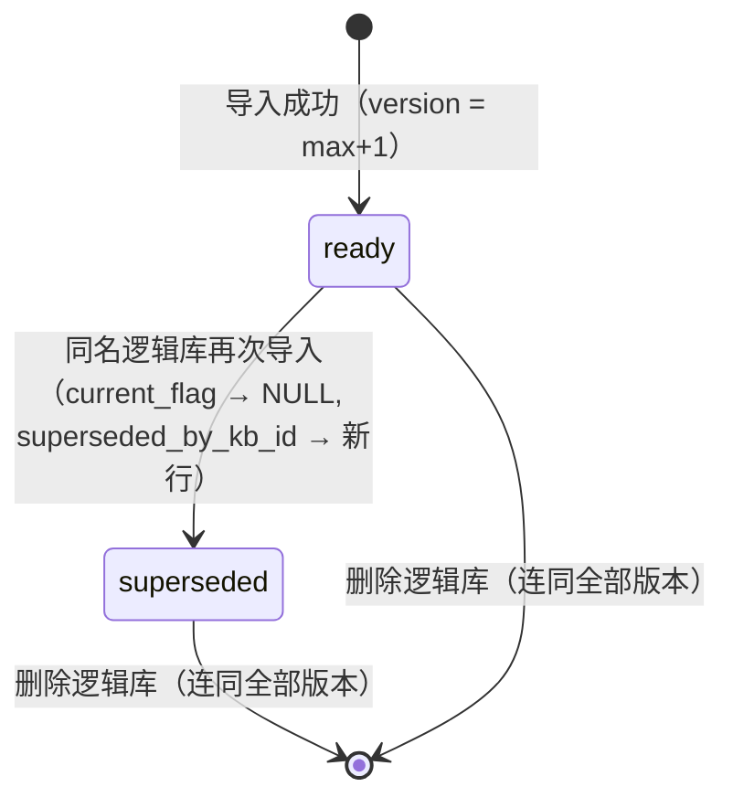
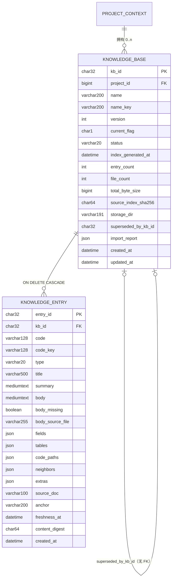
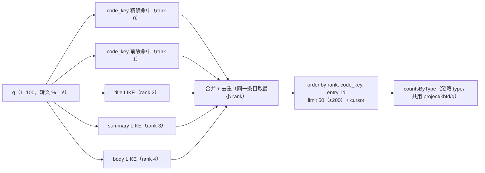

# Flowchart — knowledge-base

> 阶段：tech-design（附加产出）。含系统分层架构图、核心流程时序图与数据库 ER 图；ER 与 `docs/database-schema.md` 一致。

## 1. 系统分层架构

**依赖方向**：`api` → `services` → `knowledge`（纯函数）+ `db/repositories` + `adapters/fs`。纯解析层不依赖 FastAPI、SQLAlchemy 与文件系统；`services` 不直接访问 `AiGateway`（调用由 core 执行，本 spec 只返回 `PreparedInjection`）。

## 2. 导入流程（US-012）

失败语义：任一步失败 → 事务回滚 + 删除目录，不留文件、知识库行与条目索引（AC-012-7）。进程崩溃留下的「有目录无 DB 行」由启动扫描清理（目录 mtime 早于 1 小时才删，只记数量）。

## 3. 注入与调用流程（US-014，AC-014-4 改写版）

不变量：

- 失效、空注入与超预算三类错误都发生在**调用外部请求之前**，均不写 `AiCallRecord`、不写事件。
- 预览与发起调用使用**同一组装实现**（`preview` 与 `prepare_for_call` 共用渲染与计数），最终以服务端重算为准。
- 字符口径为 Unicode 码点；`total_chars == len(text)`，注入块尾部含分隔符，避免拼接口径漂移。

## 4. 删除流程（US-016）

## 5. 版本与状态

导入失败不产生任何行（无 `failed` 状态）。

## 6. 数据库 ER

> 唯一键：`uq_knowledge_base_project_name_current(project_id, name_key, current_flag)`、`uq_knowledge_base_project_name_version(project_id, name_key, version)`、`uq_knowledge_entry_kb_code(kb_id, code_key)`；`ai_call_record` / `session_event` 与知识库之间**无外键**。

## 7. 检索与排序

