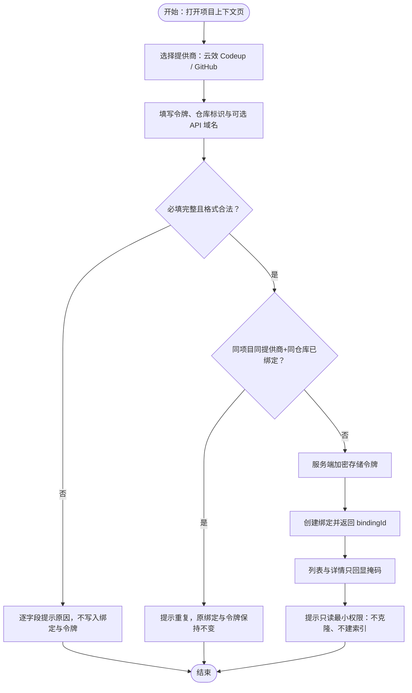
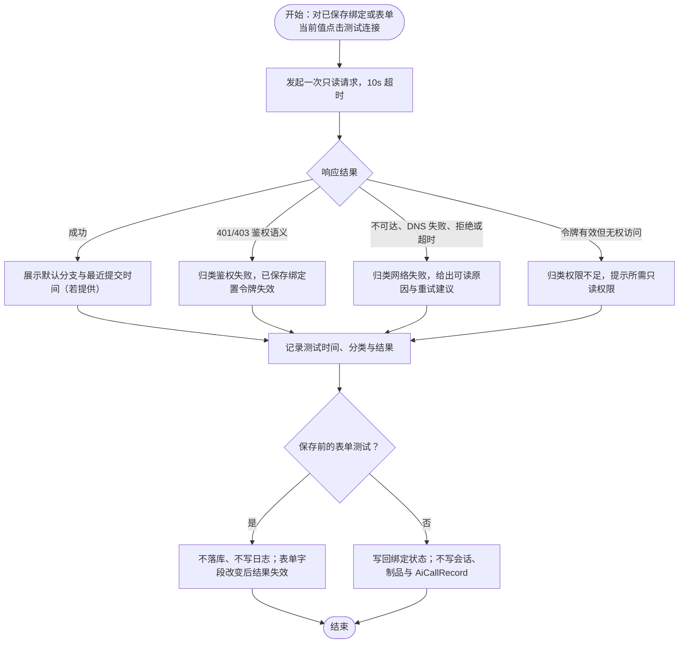
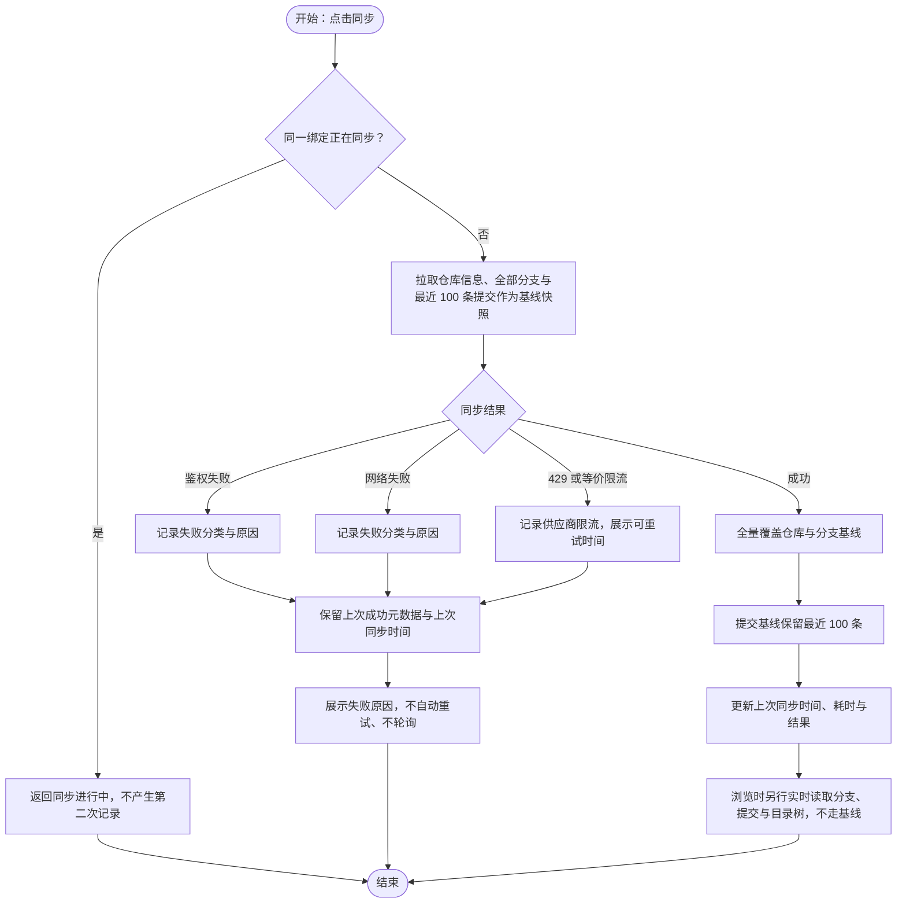
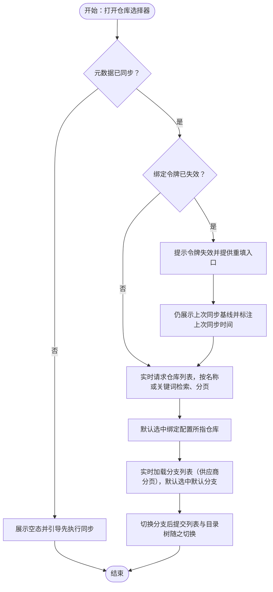
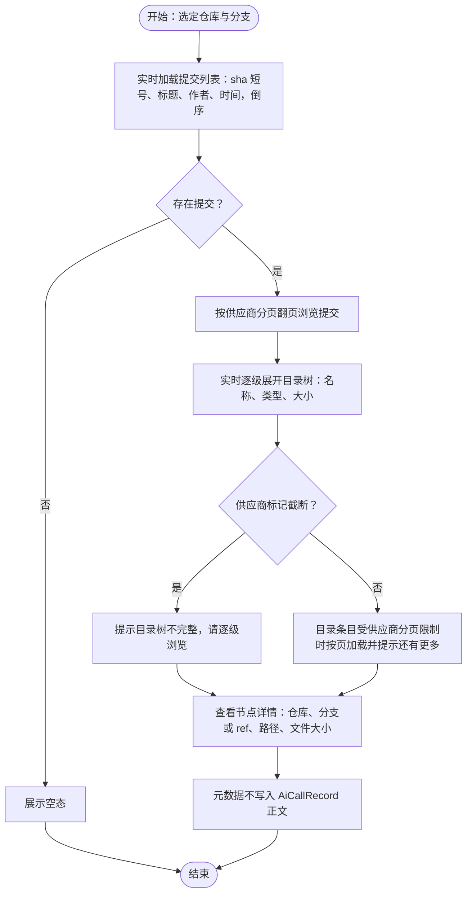
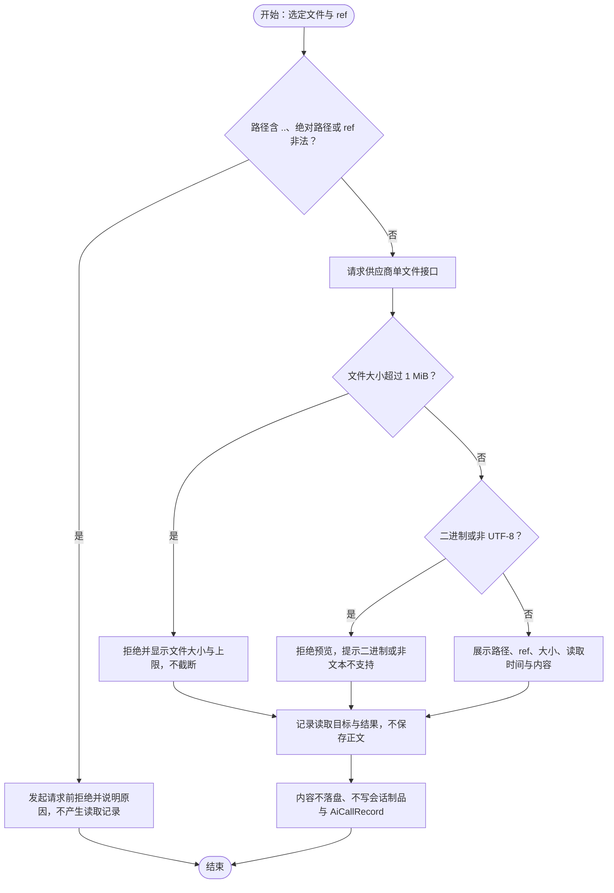
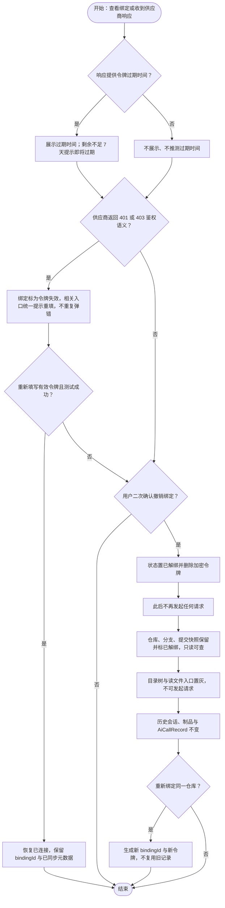

# Requirements Analysis — Flowchart

## US-017：绑定云效 / GitHub 仓库并保存访问令牌

## US-018：测试仓库连通性

## US-019：手动同步仓库元数据

## US-020：选择仓库与分支

## US-021：浏览提交与目录树

## US-022：按需读取单个文件内容

## US-023：处理令牌失效与撤销仓库绑定

