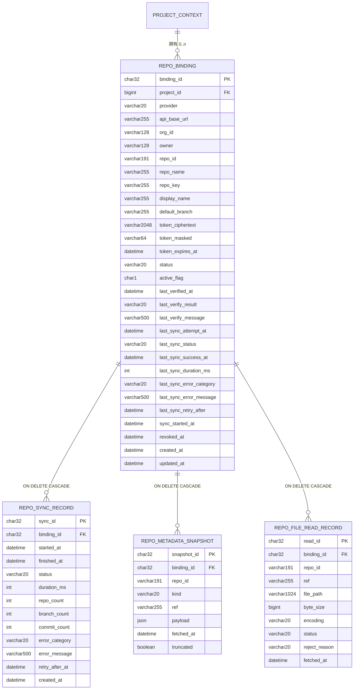

# Database Schema — repo-integration

> 阶段：tech-design（步骤 5，`data=yes`）。上游：`technical-design/docs/architecture-decisions.md`（ADR-203 / ADR-207 / ADR-210 / ADR-215）、`requirements-analysis/docs/context.md`、`design.md`「同步、并发与新鲜度」「文件读取与安全边界」。
> 生产 MySQL 8.4 LTS（InnoDB / utf8mb4 / `utf8mb4_0900_ai_ci`）；开发与默认测试 SQLite（aiosqlite）。**本 spec 只新增 4 张表，不改 core 的既有表**；迁移 `0008_repo_integration`，`down_revision="0007"`（knowledge-base 交付）。

## 实体关系图



> `project_context` 属于 core，`project_id` 为其 `BigInteger` 主键（SQLite 侧 `INTEGER`）。四张表之间除 `binding_id` 外无跨表外键；`repo_file_read_record` 不存文件正文，`repo_metadata_snapshot.payload` 只存元数据。

## 1. 通用约定（继承 core，1:1 复用）

| 约定 | 写法 | 说明 |
|------|------|------|
| 主键 | `CHAR(32)`，服务端 `uuid4().hex` | 对外 API 与进程内签名均为 `str`；与 core 的 BigInt 主键不同 |
| 外键到 core | `BigInteger().with_variant(Integer, "sqlite")` | 与 `project_context.project_id` 同型；`ON DELETE RESTRICT` |
| 子表外键 | `CHAR(32)` → `repo_binding.binding_id` | `ON DELETE CASCADE`；解绑不删行，所以删除只发生在运维级清理 |
| 时间 | `DateTime()`（应用写 UTC naive） | MySQL `DATETIME(6)`；禁 `NOW()` / `CURRENT_TIMESTAMP` |
| 布尔 | `Boolean` | MySQL `TINYINT(1)`，SQLite 0/1 |
| JSON | `sa.JSON` | 只整列读写；不建索引、不做 `JSON_EXTRACT` |
| 长文本 | `Text().with_variant(MEDIUMTEXT(), "mysql")` | 本 spec 仅 `payload` 用 JSON；不存文件正文 |
| 被索引字符串 | `VARCHAR(≤255)` | `repo_key` 255 在 utf8mb4 下 1,020 字节，加 `project_id` + `provider` + `active_flag` 仍 <3,072 |
| 大小写归一 | `repo_key` 存 Python 归一化结果 | 不依赖列 collation（MySQL `ai_ci` vs SQLite `BINARY`） |
| 表参数 | `{"mysql_engine": "InnoDB", "mysql_charset": "utf8mb4", "mysql_collate": "utf8mb4_0900_ai_ci"}` | Alembic `op.create_table` 显式声明 |
| 约束命名 | `pk_` / `fk_` / `uq_` / `ix_` / `ck_` + 表名 + 列名 | 沿用 core `naming_convention` |
| CHECK | 枚举列全部加 `CheckConstraint` | provider / status / kind / error_category / encoding / reject_reason / active_flag |
| 外键开关 | SQLite 连接建立时 `PRAGMA foreign_keys=ON` | 由 core `db/engine.py` 统一执行，本 spec 不重复实现 |

**禁止**：方言专属 DDL、partial index、生成列、`ON DUPLICATE KEY`、`INSERT OR REPLACE`、对 JSON 列建索引、把供应商响应原文写入任何列。

## 2. 表结构

### 2.1 `repo_binding`（一行 = 一个只读绑定；解绑后保留）

| 列 | 类型 | 可空 | 默认 | 约束 / 说明 |
|----|------|------|------|-------------|
| `binding_id` | `CHAR(32)` | 否 | — | PK `pk_repo_binding`；uuid4 hex |
| `project_id` | `BigInteger`（SQLite `Integer`） | 否 | — | FK `fk_repo_binding_project_id` → `project_context.project_id` `ON DELETE RESTRICT` |
| `provider` | `VARCHAR(20)` | 否 | — | `ck_repo_binding_provider`：`yunxiao` / `github` |
| `api_base_url` | `VARCHAR(255)` | 否 | — | 只存 origin；云效默认 `https://openapi-rdc.aliyuncs.com`，GitHub 固定 `https://api.github.com` |
| `org_id` | `VARCHAR(128)` | 是 | `NULL` | 云效组织 ID；GitHub 为 `NULL` |
| `owner` | `VARCHAR(128)` | 是 | `NULL` | GitHub owner；云效为 `NULL` |
| `repo_id` | `VARCHAR(191)` | 是 | `NULL` | 供应商仓库 ID：GitHub `owner/repo`；云效数字 ID 或 `group/repo` |
| `repo_name` | `VARCHAR(255)` | 否 | — | 展示用全名 / 全路径 |
| `repo_key` | `VARCHAR(255)` | 否 | — | 归一化唯一键：`casefold(provider:repo_name)`；不依赖 collation |
| `display_name` | `VARCHAR(255)` | 否 | — | 绑定行展示名，默认同 `repo_name` |
| `default_branch` | `VARCHAR(255)` | 是 | `NULL` | 同步或测试返回后更新；未知保持 `NULL` |
| `token_ciphertext` | `VARCHAR(2048)` | 是 | `NULL` | `v1:<nonce_b64>:<ciphertext_b64>`（AES-256-GCM）；解绑清空；永不进 DTO |
| `token_masked` | `VARCHAR(64)` | 是 | `NULL` | 掩码口径 `<prefix>****<last4>`；短令牌 `****`；解绑清空 |
| `token_expires_at` | `DateTime` | 是 | `NULL` | 来自 GitHub `GitHub-Authentication-Token-Expiration`；无数据 `NULL`，不推测 |
| `status` | `VARCHAR(20)` | 否 | `unverified` | `ck_repo_binding_status`：`unverified` / `connected` / `token_invalid` / `revoked` |
| `active_flag` | `CHAR(1)` | 是 | `'1'` | 在绑 `'1'`、解绑 `NULL`；`ck_repo_binding_active_flag`：`IS NULL OR = '1'` |
| `last_verified_at` | `DateTime` | 是 | `NULL` | 最近一次连通性测试时间 |
| `last_verify_result` | `VARCHAR(20)` | 是 | `NULL` | `ck_repo_binding_last_verify_result`：`success` / `auth-error` / `unreachable` / `permission-denied` |
| `last_verify_message` | `VARCHAR(500)` | 是 | `NULL` | 固定可读文案；不含令牌/响应原文 |
| `last_sync_attempt_at` | `DateTime` | 是 | `NULL` | 最近一次同步尝试（成功或失败） |
| `last_sync_status` | `VARCHAR(20)` | 是 | `NULL` | `ck_repo_binding_last_sync_status`：`success` / `failed` |
| `last_sync_success_at` | `DateTime` | 是 | `NULL` | 上次成功同步时间；失败时**保持不变** |
| `last_sync_duration_ms` | `Integer` | 是 | `NULL` | 上次成功同步耗时 |
| `last_sync_error_category` | `VARCHAR(20)` | 是 | `NULL` | 同 `repo_sync_record.error_category` |
| `last_sync_error_message` | `VARCHAR(500)` | 是 | `NULL` | 脱敏文案 |
| `last_sync_retry_after` | `DateTime` | 是 | `NULL` | 限流可重试时间；无响应头为 `NULL` |
| `sync_started_at` | `DateTime` | 是 | `NULL` | 数据库 claim 标记；TTL 900s |
| `revoked_at` | `DateTime` | 是 | `NULL` | 解绑时间 |
| `created_at` / `updated_at` | `DateTime` | 否 | — | 应用层写 UTC |

索引与唯一约束：

| 名称 | 类型 | 列 | 用途 |
|------|------|----|------|
| `uq_repo_binding_project_provider_repo_active` | UNIQUE | (`project_id`, `provider`, `repo_key`, `active_flag`) | 在绑唯一；解绑行 `active_flag=NULL` 不占键，两方言都允许多个 `NULL` |
| `ix_repo_binding_project_status` | INDEX | (`project_id`, `status`) | 项目页列表与令牌失效横幅聚合 |
| `ix_repo_binding_project_created` | INDEX | (`project_id`, `created_at`) | 列表按创建时间倒序 |

### 2.2 `repo_sync_record`（一行 = 一次同步尝试）

| 列 | 类型 | 可空 | 默认 | 约束 / 说明 |
|----|------|------|------|-------------|
| `sync_id` | `CHAR(32)` | 否 | — | PK `pk_repo_sync_record` |
| `binding_id` | `CHAR(32)` | 否 | — | FK `fk_repo_sync_record_binding_id` → `repo_binding.binding_id` `ON DELETE CASCADE` |
| `started_at` | `DateTime` | 否 | — | 点击同步的时间 |
| `finished_at` | `DateTime` | 是 | `NULL` | `running` 时为 `NULL`；崩溃恢复后置为 reclaim 时间 |
| `status` | `VARCHAR(20)` | 否 | `running` | `ck_repo_sync_record_status`：`running` / `success` / `failed` |
| `duration_ms` | `Integer` | 是 | `NULL` | 成功/失败耗时；`running` 为 `NULL` |
| `repo_count` | `Integer` | 否 | `0` | 成功为 1；失败为 0 |
| `branch_count` | `Integer` | 否 | `0` | 本次拉取的分支数 |
| `commit_count` | `Integer` | 否 | `0` | 本次写入的提交数（≤100） |
| `error_category` | `VARCHAR(20)` | 是 | `NULL` | `ck_repo_sync_record_error_category`：`auth` / `network` / `rate_limit` / `permission` / `other` / `interrupted` |
| `error_message` | `VARCHAR(500)` | 是 | `NULL` | 固定可读文案，不含响应原文 |
| `retry_after_at` | `DateTime` | 是 | `NULL` | 限流可重试时间（若有） |
| `created_at` | `DateTime` | 否 | — | 写入顺序依据 |

索引：

| 名称 | 类型 | 列 | 用途 |
|------|------|----|------|
| `ix_repo_sync_record_binding_started` | INDEX | (`binding_id`, `started_at`) | 最近记录列表与 reclaim 查询 |

### 2.3 `repo_metadata_snapshot`（一行 = 一条基线元数据；每次成功同步全量替换）

| 列 | 类型 | 可空 | 默认 | 约束 / 说明 |
|----|------|------|------|-------------|
| `snapshot_id` | `CHAR(32)` | 否 | — | PK `pk_repo_metadata_snapshot` |
| `binding_id` | `CHAR(32)` | 否 | — | FK `fk_repo_metadata_snapshot_binding_id` → `repo_binding.binding_id` `ON DELETE CASCADE` |
| `repo_id` | `VARCHAR(191)` | 否 | — | 快照对应的供应商仓库 ID |
| `kind` | `VARCHAR(20)` | 否 | — | `ck_repo_metadata_snapshot_kind`：`repo` / `branch` / `commit` / `tree`（`tree` 为 ENT-C14 合法值，但按 AMB-026 **从不写入**） |
| `ref` | `VARCHAR(255)` | 是 | `NULL` | 分支 / tag / commit；`kind=repo` 时为默认分支 |
| `payload` | `JSON` | 否 | — | 归一化字段：名称、ID、sha、标题、作者、时间、路径、文件大小；**不含文件正文、不含供应商原始 JSON** |
| `fetched_at` | `DateTime` | 否 | — | 本次同步拉取时间 |
| `truncated` | `Boolean` | 否 | `false` | 供应商截断信号；同步基线当前恒为 `false`（不拉目录树） |

索引：

| 名称 | 类型 | 列 | 用途 |
|------|------|----|------|
| `ix_repo_metadata_snapshot_binding_kind_fetched` | INDEX | (`binding_id`, `kind`, `fetched_at`) | baseline 按类型取最新 |
| `ix_repo_metadata_snapshot_binding_fetched` | INDEX | (`binding_id`, `fetched_at`) | 全量替换与清理 |

### 2.4 `repo_file_read_record`（一行 = 一次读取审计；不存正文）

| 列 | 类型 | 可空 | 默认 | 约束 / 说明 |
|----|------|------|------|-------------|
| `read_id` | `CHAR(32)` | 否 | — | PK `pk_repo_file_read_record` |
| `binding_id` | `CHAR(32)` | 否 | — | FK `fk_repo_file_read_record_binding_id` → `repo_binding.binding_id` `ON DELETE CASCADE` |
| `repo_id` | `VARCHAR(191)` | 否 | — | 供应商仓库 ID |
| `ref` | `VARCHAR(255)` | 否 | — | 已通过校验的 ref |
| `file_path` | `VARCHAR(1024)` | 否 | — | 已通过校验的相对路径；仅元数据 |
| `byte_size` | `BigInteger` | 是 | `NULL` | 供应商返回或探测到的大小；超限拒绝时记录实际值 |
| `encoding` | `VARCHAR(20)` | 否 | — | `ck_repo_file_read_record_encoding`：`text` / `base64`（供应商返回的原始编码） |
| `status` | `VARCHAR(20)` | 否 | — | `ck_repo_file_read_record_status`：`success` / `refused` |
| `reject_reason` | `VARCHAR(20)` | 是 | `NULL` | `ck_repo_file_read_record_reject_reason`：`too_large` / `binary` / `not_utf8`；成功为 `NULL` |
| `fetched_at` | `DateTime` | 否 | — | 读取时间 |

索引：

| 名称 | 类型 | 列 | 用途 |
|------|------|----|------|
| `ix_repo_file_read_record_binding_fetched` | INDEX | (`binding_id`, `fetched_at`) | 按绑定查看读取历史 |

> 非法路径 / 非法 ref 在请求前拒绝，**不写本表**（AC-022-5）；超限、二进制、非 UTF-8 写 `status=refused`。

## 3. 完整性、级联与删除口径

- `ProjectContext 1 ─ n RepoBinding 1 ─ n {SyncRecord, MetadataSnapshot, FileReadRecord}`；删除项目被 `RESTRICT` 阻止（core 不提供项目删除接口）。
- 解绑**不删行**：`status='revoked'`、`active_flag=NULL`、`token_ciphertext=NULL`、`token_masked=NULL`、`revoked_at=now`；快照、同步记录、读取记录保留只读（AC-023-4 / AC-023-5）。
- 重新绑定同一仓库：插入新 `binding_id` 行，`active_flag='1'`；旧行保持 `revoked`/`NULL`，不复用旧令牌与旧同步记录（AC-023-6）。
- 仅运维级删除（用户显式要求清库）才会触发 `ON DELETE CASCADE`；应用层不提供删除绑定/记录接口。
- 历史会话、制品、`AiCallRecord` 与四张表**无外键**；解绑不改写任何历史数据。

## 4. 迁移策略

### 4.1 迁移链

```
0001_auth → 0002_project_provider_model → 0003_session_event
          → 0004_artifact → 0005_ai_call_record
          → 0006_knowledge_injection（core）
          → 0007_knowledge_base（knowledge-base spec）
          → 0008_repo_integration（本 spec）
```

- 文件：`migrations/versions/0008_repo_integration.py`，`revision="0008"`，`down_revision="0007"`。
- 前置：`0007` 必须先落地；本 spec 的 `0008` 不引用 `knowledge_base` / `knowledge_entry` 的列，只保证线性历史。
- 本 spec 不改任何 core / knowledge-base 表的列、约束与 CHECK；`0008` 只做四张新表的 `create_table`。
- 合并前核对：`alembic heads` 只输出 `0008`；CI 从空库跑 `0001 → 0008`。

### 4.2 升级 / 降级

```python
def upgrade() -> None:
    op.create_table("repo_binding", ...)            # 父表
    op.create_table("repo_sync_record", ...)        # 子表 FK CASCADE
    op.create_table("repo_metadata_snapshot", ...)  # 子表 FK CASCADE
    op.create_table("repo_file_read_record", ...)   # 子表 FK CASCADE

def downgrade() -> None:
    op.drop_table("repo_file_read_record")          # 先子表
    op.drop_table("repo_metadata_snapshot")
    op.drop_table("repo_sync_record")
    op.drop_table("repo_binding")
```

- 新建表无需 `batch_alter_table`；不使用方言专属参数。`sa.JSON` 在 MySQL 为 `JSON`、SQLite 为 `TEXT`；`MEDIUMTEXT` 通过 `sa.Text().with_variant(mysql.MEDIUMTEXT(), "mysql")`（本期仅审计/错误文案若超长时使用）。
- 自检：`tests/test_repo_migrations.py` 在 SQLite 临时文件库与 MySQL CI 容器上各跑 `upgrade head` → `downgrade 0007` → `upgrade head`，断言四表、索引、CHECK、`ON DELETE CASCADE` 均存在（TC-247）。

### 4.3 双方言差异清单

| 差异点 | MySQL 8.4 | SQLite | 处理 |
|--------|-----------|--------|------|
| 大文本 | `TEXT` 仅 64KB，非严格模式静默截断 | `TEXT` 无限制 | 需要长文本时强制 `MEDIUMTEXT` 变体；本 spec 不存文件正文，`payload` 走 JSON |
| JSON | 原生 `JSON`，不能直接建索引 | `TEXT` 存 JSON | `sa.JSON`，只用整列读写，不建索引、不做 `JSON_EXTRACT` |
| 可空唯一 | 唯一索引允许多个 `NULL` | 同 | `active_flag` 用 `'1'` / `NULL`，不用 `'0'` |
| 大小写唯一 | 默认 `ai_ci` | 默认 `BINARY` | 唯一性落在 `repo_key`（应用层 `casefold`） |
| 外键级联 | InnoDB 支持 | 需 `PRAGMA foreign_keys=ON` | 连接建立时统一开启（core `db/engine.py`） |
| CHECK | 8.4 强制执行 | 强制执行 | 枚举列全部加约束；变更需新建迁移 |
| 时间 | `DATETIME(6)` | ISO 文本 | 应用层写 UTC naive，禁数据库时间函数 |
| 布尔 | `TINYINT(1)` | 0/1 | `Boolean` 统一映射 |

## 5. 容量与性能边界

| 对象 | 预期量级 | 依据 / 说明 |
|------|---------|-------------|
| `repo_binding` | 单项目 <10 行（含已解绑）；全局 0..n | AMB-025 不设硬上限；建议 ≤5 个 |
| `repo_sync_record` | 单绑定每次同步 1 行；一年量级 <1,000 行 | 不做定时同步；按需手动 |
| `repo_metadata_snapshot` | 单绑定每次成功同步 1 + 分支数 + ≤100 行 | 全量替换；提交滚动 100 条；目录树不写入 |
| `repo_file_read_record` | 单绑定每次读取 1 行 | 只存元数据；超限/二进制/非 UTF-8 也记 1 行 |
| 单行 `payload` | ≤数 KB | 归一化元数据；不含正文与原始响应 |
| 查询主路径 | `(project_id, created_at)` 列表、`(binding_id, started_at)` 记录、`(binding_id, kind, fetched_at)` 基线 | 均有索引；无 N+1 |
