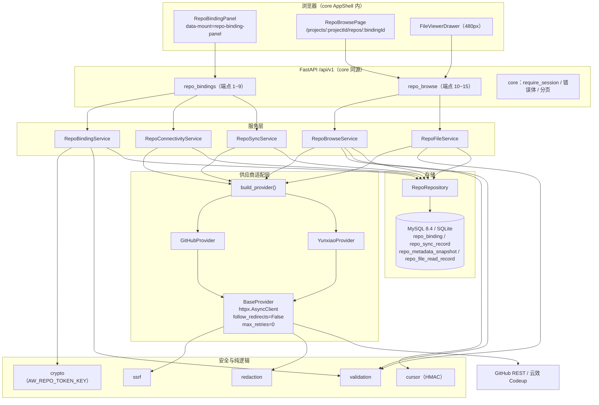
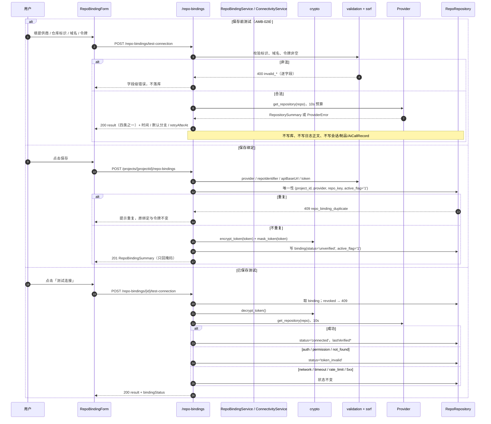
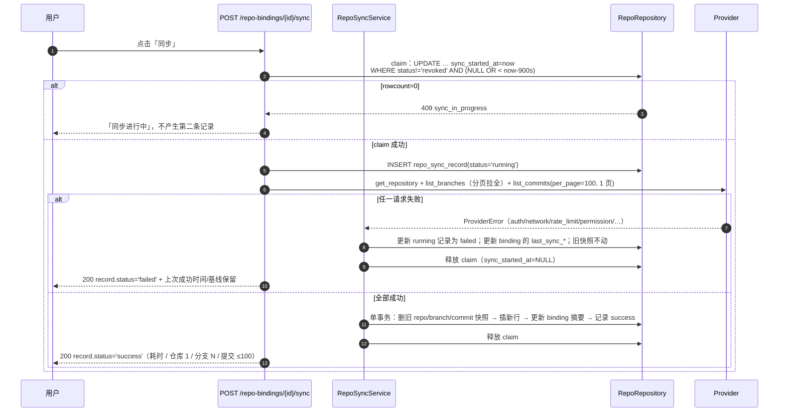
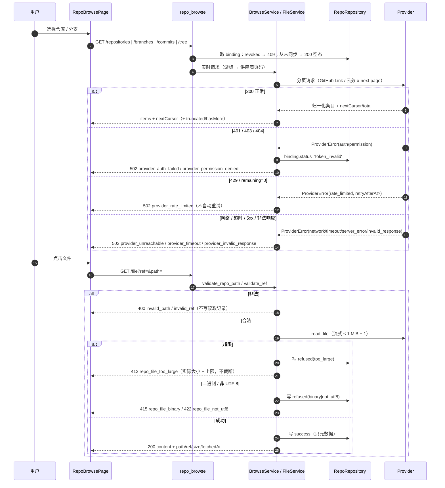
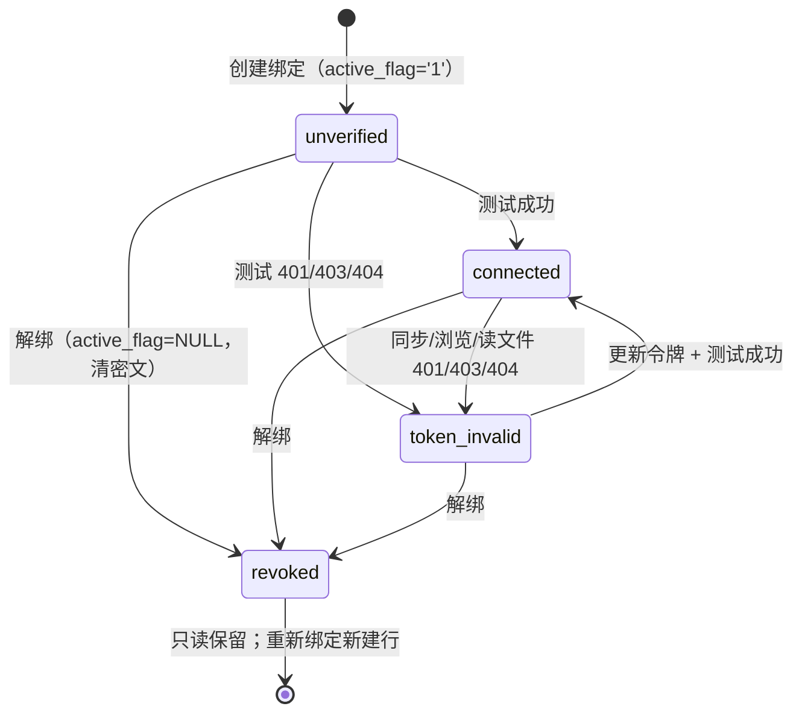
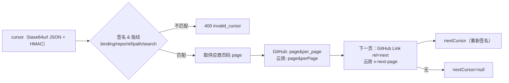
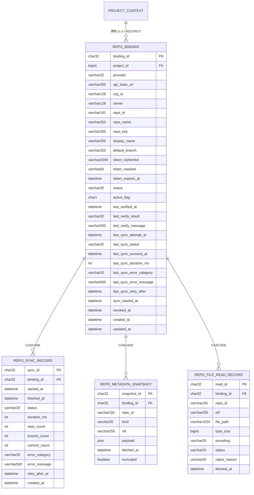

# Flowchart — repo-integration

> 阶段：tech-design（附加产出）。含系统分层架构图、核心流程时序图、状态机与数据库 ER；ER 与 `docs/database-schema.md` 一致。

## 1. 系统分层架构

**依赖方向**：`api` → `services` → `repos`（纯逻辑 + 适配器）+ `db/repositories`。适配器不写 DB；服务层不拼 URL；前端只消费归一化 DTO。

## 2. 绑定与测试连接（US-017 / US-018）

## 3. 同步基线（US-019）

不变量：

- 网络 IO 全部在写事务之外完成；写事务只做「删旧 + 插新 + 更新摘要 + 写记录」。
- 失败时 `last_sync_success_at` 与四类快照保持上次成功值（AC-019-3）。
- 崩溃遗留的 `running` 记录在下一次 claim 时归并为 `failed(interrupted)`；claim TTL 900s。
- 同步不拉目录树与文件内容（AMB-023 / AMB-026）；提交固定 `per_page=100`、最多 1 页。

## 4. 实时浏览与按需读文件（US-020 / US-021 / US-022）

## 5. 绑定状态机

- 网络失败、超时、限流、5xx 不改变状态（AC-018-3 / ADR-206）。
- `revoked` 为终态；重新绑定同一仓库生成新 `binding_id` 与新令牌（AC-023-6）。

## 6. 分页与游标

## 7. 数据库 ER

> 唯一键：`uq_repo_binding_project_provider_repo_active(project_id, provider, repo_key, active_flag)`；`repo_sync_record` / `repo_metadata_snapshot` / `repo_file_read_record` 与 core 表之间无外键。
